# 1. Portada

**INFORME TÉCNICO FINAL**
**Práctica individual de Ejecución de Pruebas y Calidad de Software**
**Proyecto: GEOEDUCA – Control Escolar**

| Campo | Dato |
|---|---|
| Estudiante | **[COMPLETAR: nombre y apellidos]** |
| Asignatura | **[COMPLETAR: nombre de la asignatura]** |
| Docente | **[COMPLETAR: nombre del docente]** |
| Sección / grupo | **[COMPLETAR]** |
| Institución | **[COMPLETAR]** |
| Fecha de entrega | **[COMPLETAR]** |
| Repositorio | repositorio privado de la práctica (no publicado), rama `practica-pruebas-calidad` |
| Último commit publicado | `b326574` |

> Los campos marcados **[COMPLETAR]** no se rellenaron a propósito: son datos personales o institucionales que no constan en el repositorio.

**Convención de este informe.** Se distingue entre **resultados comprobados** (cifras tomadas de archivos del repositorio, con la ruta de la evidencia), **interpretaciones** (juicios del autor, señalados como tales),
**limitaciones** y **actividades pendientes**. Las rutas son relativas a `docs/01-guia-pruebas-calidad/`, salvo las que empiezan por `backend/`, `frontend/` o `sonar/`.
**No se corrigió ningún defecto ni se desarrolló ninguna funcionalidad**: el código de producción (`backend/app`, `backend/routes`, `backend/config`, `backend/bootstrap`, `frontend/src`)
no se modificó (`git diff` sin cambios en esas rutas entre el commit `5766b24` y el árbol de trabajo).

---

# 2. Descripción del proyecto de software

## 2.1 Datos generales (Tabla 1 de la guía)

| Campo | Descripción |
|---|---|
| **Nombre del proyecto** | GEOEDUCA – Control Escolar |
| **Objetivo del software** | Plataforma de control de asistencia escolar en tiempo real. Según la interfaz y el diseño del prototipo, busca que el ingreso y la salida de los estudiantes se registren mediante QR dinámico, geolocalización y lectores en puerta, y que los padres o tutores reciban avisos y puedan justificar inasistencias, mientras el personal auxiliar gestiona los casos de contingencia en la puerta. **[Confirmar con el autor la redacción oficial del problema y la finalidad]** |
| **Tecnologías utilizadas** | Ver 2.2 |
| **Funcionalidades principales** | Ver 2.3 (implementadas, simuladas y no existentes) |
| **Entorno de ejecución** | Local, en Windows (compilación 10.0.26200): backend Laravel con `php artisan serve` en `http://127.0.0.1:8000`, frontend React con Vite en `http://localhost:5173` (proxy de `/api` hacia el backend) y SonarQube en Docker en `http://localhost:9000` |
| **Herramientas de pruebas** | PHPUnit 11.5.57 y Mockery 1.6.15 (automatización), peticiones HTTP con PowerShell y navegador integrado de Cursor (pruebas manuales), SonarQube Community Build 26.10.0.133078 con SonarScanner CLI 8.1 (análisis estático), `composer audit` y `npm audit` (dependencias) |

## 2.2 Tecnologías realmente utilizadas

| Capa | Tecnología y versión | Observación |
|---|---|---|
| Lenguaje del backend | PHP 8.2.12 | |
| Framework del backend | Laravel 11.57.0 | `backend/composer.lock` |
| Autenticación declarada | Laravel Sanctum 4.3.3 | **Instalado pero sin uso**: la autenticación es simulada (`MockUserAuthenticator`, `DemoAccounts`) |
| Base de datos | **Ninguna en uso** | SQLite figura en la configuración (`DB_CONNECTION=sqlite`), pero no hay modelos ni migraciones; los datos de los paneles son fijos |
| Frontend | React 18.3.1 con react-router-dom 6.30.6 | |
| Empaquetado | Vite 5.4.21 | |
| Estilos y cliente HTTP | Tailwind CSS 3.4.19 y Axios 1.20.0 | |
| Entorno de ejecución del frontend | Node v24.19.0 | |

## 2.3 Funcionalidades: implementadas, simuladas y no existentes

| Funcionalidad | Estado real | Evidencia |
|---|---|---|
| Inicio de sesión por perfil (estudiante, padre/tutor, docente/auxiliar) | **Implementada con autenticación simulada**: cuentas de demostración y tokens `mock-…` que no se validan | F-02 a F-04, UI-01, UI-09, UI-10 |
| Validación de datos del login (DNI de 8 dígitos, contraseña, perfil) | **Implementada** en frontend y backend | V-01 a V-06, UI-02 |
| Endpoints de asistencia (`estudiante`, `padre`, `auxiliar/casos`, `auxiliar/aprobar`, `justificacion`) | **Implementados como contrato**: responden y validan, pero devuelven datos fijos y no guardan nada | F-05, F-06, V-07 a V-09, B-04 |
| Tres paneles (estudiante, padre/tutor, auxiliar) | **Simulados**: muestran datos fijos y una fecha fija («Lunes, 24 Octubre 2025», marcada como «Sincronizado») | UI-01, UI-07, UI-09, UI-10 |
| Cierre de sesión | **Solo del lado del cliente**: el servidor no invalida el token | UI-05, S-06 |
| Protección de rutas del frontend | **Solo del lado del cliente**: se salta editando `localStorage` | UI-03, UI-06 |
| QR dinámico | **No existe**: el QR es un gráfico estático; no hay endpoints de QR | UI-08, B-01 |
| Geolocalización | **No existe**: el aviso «Geo-Verificación Activa» es solo de interfaz | B-02 |
| Notificaciones a los padres | **No existen**: los avisos de los paneles son datos fijos | B-03 |
| Persistencia (base de datos) | **No existe** | B-04 |

*Interpretación:* los resultados de este informe describen un **prototipo de interfaz con una API de contrato**, no un sistema funcional. Por eso muchos requisitos de seguridad
no se cumplen y las funcionalidades centrales no se pueden evaluar.

---

# 3. Identificación y planificación de las pruebas

## 3.1 Tipos de prueba seleccionados y justificación (Tabla 2)

Se seleccionaron **seis tipos de prueba manuales** y, además, pruebas automatizadas y análisis estático. La guía exige al menos tres, justificados.

| Tipo de prueba | Casos | Qué verifica en GEOEDUCA | Justificación |
|---|---:|---|---|
| Funcional | 19 | Login de los tres perfiles, salud de la API, contratos de justificación y aprobación, y funcionalidades no implementadas | Comprueba que lo que el sistema promete a cada perfil funciona de extremo a extremo y deja constancia de lo que no existe |
| Validación de datos | 10 | DNI, contraseña, perfil y formularios (respuestas 422 con errores por campo) | La validación es la primera barrera ante entradas incorrectas y está duplicada en frontend y backend |
| Seguridad | 15 | Autenticación, autorización por rol, cierre de sesión, límite de intentos, cabeceras, errores y entradas hostiles | El sistema manejará datos de menores y su ubicación; la seguridad debe poder demostrarse |
| Integración | 4 | Proxy de Vite hacia Laravel, CORS y contratos JSON | Frontend y backend son procesos separados; muchos fallos reales aparecen en su unión |
| Usabilidad | 1 | Diseño adaptable a móvil (375 px) | El auxiliar de puerta usaría el panel desde dispositivos pequeños |
| Resiliencia | 1 | Comportamiento si el backend no responde | Un servicio caído no debe dejar al usuario sin explicación |
| **Total** | **50** | | |

Complementos: **pruebas automatizadas** de caracterización, unitarias y de requisitos de seguridad (PHPUnit, 124 casos) y **análisis estático** (SonarQube), que encuentra clases de problemas que las pruebas dinámicas no ejercitan,
como la accesibilidad. **No se planificaron pruebas de rendimiento ni de carga**: el prototipo no tiene persistencia ni lógica de negocio sobre la que medirlas.

## 3.2 Matriz de planificación (Tabla 3)

Los 50 casos reutilizan las matrices originales (`api/matriz-resultados-api.md`, `matriz-resultados-ui.md`); esta tabla se generó por programa sin transcripción manual y está también en `PLAN-DE-PRUEBAS.md`.
Las precondiciones, los datos de entrada ficticios y el resultado real de cada caso se presentan en 4.2.

### Casos de API (38)

| ID | Funcionalidad | Tipo de prueba | Procedimiento | Resultado esperado | Referencia a la ejecución |
|---|---|---|---|---|---|
| F-01 | Endpoint de salud | Funcional | GET /api/health con Accept: application/json | 200 y cuerpo {"status":"ok"} | **Aprobado**. `api/TC-F-01.json` |
| F-02 | Inicio de sesión de estudiante | Funcional | POST /api/auth/login | 200, rol student, token presente y sin campo password en la respuesta | **Aprobado**. `api/TC-F-02.json` |
| F-03 | Inicio de sesión de padre/tutor | Funcional | POST /api/auth/login | 200, rol parent, token presente | **Aprobado**. `api/TC-F-03.json` |
| F-04 | Inicio de sesión de personal (docente/auxiliar) | Funcional | POST /api/auth/login | 200, rol staff, token presente | **Aprobado**. `api/TC-F-04.json` |
| F-05 | Envío de justificación (contrato de la API) | Funcional | POST /api/asistencia/justificacion con Authorization Bearer | 200 con mensaje de envío y eco de los datos validados (la persistencia se evalúa en B-04) | **Aprobado**. `api/TC-F-05.json` |
| F-06 | Aprobación manual de ingreso (contrato de la API) | Funcional | POST /api/asistencia/auxiliar/aprobar con Authorization Bearer | 200 con mensaje y eco de los datos validados (la persistencia se evalúa en B-04) | **Aprobado**. `api/TC-F-06.json` |
| V-01 | Validación de DNI corto | Validación de datos | POST /api/auth/login | 422 con error en el campo identifier | **Aprobado**. `api/TC-V-01.json` |
| V-02 | Validación de contraseña corta | Validación de datos | POST /api/auth/login | 422 con error en el campo password (mínimo 8) | **Aprobado**. `api/TC-V-02.json` |
| V-03 | Validación de perfil inexistente | Validación de datos | POST /api/auth/login | 422 con error en el campo role | **Aprobado**. `api/TC-V-03.json` |
| V-04 | Validación de formulario vacío | Validación de datos | POST /api/auth/login | 422 con errores en identifier, password y role | **Aprobado**. `api/TC-V-04.json` |
| V-05 | Validación de DNI con letras | Validación de datos | POST /api/auth/login | 422 con error en identifier | **Aprobado**. `api/TC-V-05.json` |
| V-06 | Validación de contraseña demasiado larga | Validación de datos | POST /api/auth/login | 422 con error en password (máximo 128) | **Aprobado**. `api/TC-V-06.json` |
| V-07 | Validación de motivo de justificación corto | Validación de datos | POST /api/asistencia/justificacion | 422 con error en reason (mínimo 10) | **Aprobado**. `api/TC-V-07.json` |
| V-08 | Validación de tipo de justificación inexistente | Validación de datos | POST /api/asistencia/justificacion | 422 con error en type | **Aprobado**. `api/TC-V-08.json` |
| V-09 | Validación de aprobación manual sin motivo | Validación de datos | POST /api/asistencia/auxiliar/aprobar | 422 con error en reason | **Aprobado**. `api/TC-V-09.json` |
| N-01 | Rechazo de contraseña incorrecta | Funcional (negativo) | POST /api/auth/login | 401 con mensaje genérico y sin token | **Aprobado**. `api/TC-N-01.json` |
| N-02 | Rechazo de credencial de otro perfil | Funcional (negativo) | POST /api/auth/login | 401 y sin token (no se puede entrar a un perfil con la credencial de otro) | **Aprobado**. `api/TC-N-02.json` |
| N-03 | No enumeración de usuarios en el login | Seguridad | POST /api/auth/login y comparar el cuerpo con el de N-01 | 401 con respuesta idéntica a la de contraseña incorrecta (no revela si el DNI existe) | **Aprobado**. `api/TC-N-03.json` |
| I-01 | Proxy de Vite hacia la API | Integración | GET http://localhost:5173/api/health | 200 {"status":"ok"} (Vite reenvía a Laravel) | **Aprobado**. `api/TC-I-01.json` |
| I-02 | Login a través del proxy (frontend a backend) | Integración | POST http://localhost:5173/api/auth/login | 200 con token y usuario, igual que contra Laravel directo | **Aprobado**. `api/TC-I-02.json` |
| I-03 | CORS: origen permitido | Integración | OPTIONS /api/auth/login (preflight) | 204 y Access-Control-Allow-Origin igual al origen | **Aprobado**. `api/TC-I-03.json` |
| I-04 | CORS: origen no autorizado | Seguridad | OPTIONS /api/auth/login (preflight) | Sin cabecera Access-Control-Allow-Origin (el navegador bloquea al origen ajeno) | **Aprobado**. `api/TC-I-04.json` |
| I-05 | Robustez: cliente de API sin cabecera Accept | Integración | POST /api/auth/login sin Accept (sin seguir redirecciones) | 422 con JSON de errores: una ruta de API no debe responder con redirección HTML | **Fallido**. `api/TC-I-05.json` |
| S-01 | Perfil autenticado sin credenciales | Seguridad | GET /api/auth/me | Sistema seguro: 401 Unauthorized | **Fallido**. `api/TC-S-01.json` |
| S-02 | Casos del auxiliar sin autenticación | Seguridad | GET /api/asistencia/auxiliar/casos | Sistema seguro: 401 Unauthorized | **Fallido**. `api/TC-S-02.json` |
| S-03 | Aprobación manual sin autenticación | Seguridad | POST /api/asistencia/auxiliar/aprobar | Sistema seguro: 401 Unauthorized | **Fallido**. `api/TC-S-03.json` |
| S-04 | Rechazo de token falso | Seguridad | GET /api/asistencia/estudiante | Sistema seguro: 401 Unauthorized | **Fallido**. `api/TC-S-04.json` |
| S-05 | Autorización por rol: estudiante en endpoint de personal | Seguridad | GET /api/asistencia/auxiliar/casos con token de estudiante | Sistema seguro: 403 Forbidden | **Fallido**. `api/TC-S-05.json` |
| S-06 | Invalidación del token al cerrar sesión | Seguridad | 1) POST /api/auth/login  2) POST /api/auth/logout con el token  3) GET /api/auth/me con el mismo token | Sistema seguro: tras el logout, /me responde 401 | **Fallido**. `api/TC-S-06.json` |
| S-07 | Resistencia a inyección SQL en el login | Seguridad | POST /api/auth/login (dos peticiones) | 401 o 422, sin token, sin error de base de datos ni 500 | **Aprobado**. `api/TC-S-07.json` |
| S-08 | Limitación de intentos de login (fuerza bruta) | Seguridad | 12 × POST /api/auth/login | Sistema seguro: algún intento recibe 429 Too Many Requests | **Fallido**. `api/TC-S-08.json` |
| S-09 | No divulgación de versión de tecnología | Seguridad | GET /api/health y revisar cabeceras de respuesta | Sin cabecera X-Powered-By | **Fallido**. `api/TC-S-09.json` |
| S-10 | Cabeceras de seguridad HTTP básicas | Seguridad | GET /api/health y revisar cabeceras de respuesta | Presente X-Content-Type-Options: nosniff | **Fallido**. `api/TC-S-10.json` |
| S-11 | Los errores no filtran detalles internos | Seguridad | GET /api/ruta-que-no-existe-geoeduca | 404 con mensaje genérico, sin traza, rutas de archivo ni nombres de clases | **Fallido**. `api/TC-S-11.json` |
| B-01 | Emisión y validación de QR dinámico | Funcional (no implementado) | Buscar rutas de emisión/validación de QR en route:list | Existen endpoints para emitir un QR con expiración y validarlo una sola vez | **Bloqueado**. `api/TC-B-01.json` |
| B-02 | Validación de geolocalización y geocerca | Funcional (no implementado) | Buscar rutas de geolocalización en route:list | Existe un endpoint que valide coordenadas contra una geocerca en el servidor | **Bloqueado**. `api/TC-B-02.json` |
| B-03 | Notificaciones a apoderados | Funcional (no implementado) | Buscar rutas de notificaciones en route:list | Existen endpoints y mecanismo de envío con registro de intentos | **Bloqueado**. `api/TC-B-03.json` |
| B-04 | Persistencia y consulta de justificaciones | Funcional (no implementado) | 1) POST /api/asistencia/justificacion  2) GET /api/asistencia/padre | La justificación enviada aparece en la consulta del padre | **Bloqueado**. `api/TC-B-04.json` |

### Casos de interfaz (12)

| ID | Funcionalidad | Tipo de prueba | Procedimiento | Resultado esperado | Referencia a la ejecución |
|---|---|---|---|---|---|
| UI-01 | Inicio de sesión de estudiante en la interfaz | Funcional / Integración | Abrir `/login`, escribir datos, pulsar «Ingresar» | Redirige a `/estudiante`, guarda usuario con rol student y token, y la petición llega a `/api/auth/login` | **Aprobado**. `ui/UI-01_login-estudiante-panel-y-fecha-fija.png`, `ui/mediciones-dom.json` |
| UI-02 | Validación en vivo del formulario | Validación de datos | Escribir ambos valores sin enviar | Mensajes de error bajo cada campo y botón «Ingresar» deshabilitado | **Aprobado**. `ui/UI-02_validacion-en-vivo-dni-y-contrasena.png` |
| UI-03 | Redirección de ruta protegida sin sesión | Seguridad (cliente) | Abrir `http://localhost:5173/auxiliar` | Redirige a `/login` | **Aprobado**. `ui/UI-03_ruta-protegida-sin-sesion-redirige-a-login.png` |
| UI-04 | Rechazo de credencial incorrecta | Funcional (negativo) | Pulsar «Ingresar» | Mensaje de error visible, sin sesión ni token guardados | **Aprobado**. `ui/UI-04_credencial-incorrecta-mensaje-de-error.png`, `ui/mediciones-dom.json` |
| UI-05 | Cierre de sesión | Funcional | Pulsar «Cerrar sesión» | Vuelve a `/login` y se borra la sesión local | **Aprobado**. `ui/mediciones-dom.json` |
| UI-06 | Autorización por rol (manipulación del navegador) | Seguridad | Editar el valor y abrir `/auxiliar` | Sistema seguro: acceso denegado por el servidor, sin mostrar datos de otros alumnos | **Fallido**. `ui/UI-06_rol-manipulado-abre-panel-auxiliar.png`, `ui/mediciones-dom.json` |
| UI-07 | Fecha y hora del panel | Funcional | Comparar la fecha mostrada con la del navegador | La fecha mostrada coincide con la fecha real | **Fallido**. `ui/UI-01_login-estudiante-panel-y-fecha-fija.png`, `ui/mediciones-dom.json` |
| UI-08 | QR dinámico: el QR cambia al renovar | Funcional | Calcular la huella del SVG del QR, pulsar «Generar Nuevo Código QR», recalcular | El contenido del QR cambia al renovarse | **Fallido**. `ui/mediciones-dom.json` |
| UI-09 | Inicio de sesión de padre/tutor en la interfaz | Funcional | Abrir `/login`, elegir «Padre / Tutor», escribir los datos y pulsar «Ingresar» | Redirige a `/padre` y guarda usuario con rol parent y token | **Aprobado**. `ui/UI-09_login-padre-redirige-a-panel-padre.png`, `ui/mediciones-dom-ui09-ui12.json` |
| UI-10 | Inicio de sesión de docente/auxiliar en la interfaz | Funcional | Abrir `/login`, elegir «Docente», escribir los datos y pulsar «Ingresar» | Redirige a `/auxiliar` y guarda usuario con rol staff y token | **Aprobado**. `ui/UI-10_login-docente-redirige-a-panel-auxiliar.png`, `ui/mediciones-dom-ui09-ui12.json` |
| UI-11 | Diseño adaptable a móvil | Usabilidad | Emular el viewport, medir el desborde de la página y de cada elemento, y revisar la captura | Menú adaptado y sin desbordes ni contenido cortado | **Fallido**. `ui/UI-11_vista-movil-375px-panel-auxiliar.png`, `ui/UI-11_contenido-recortado-en-375px.png`, `ui/mediciones-dom-ui09-ui12.json` |
| UI-12 | Mensaje si el backend no responde | Resiliencia | Detener Laravel, abrir `/login`, enviar el formulario | Mensaje claro de que no hay conexión con el servidor | **Fallido**. `ui/UI-12_backend-caido-mensaje-tecnico-500.png`, `ui/mediciones-dom-ui09-ui12.json` |


---

# 4. Ejecución de las pruebas y resultados obtenidos

## 4.1 Preparación del entorno (checklist de la guía)

| Aspecto | Estado | Detalle |
|---|---|---|
| Proyecto operativo | Cumplido | Laravel en `127.0.0.1:8000` y Vite en `localhost:5173`; `GET /api/health` responde `200` (F-01) |
| Dependencias instaladas | Cumplido | `backend/composer.lock` y `frontend/package-lock.json`; PHPUnit y Mockery añadidos al backend (commit `5766b24`) |
| Base de datos y servicios | **No aplica base de datos** | No hay modelos ni migraciones; la autenticación es simulada. Los únicos servicios son Laravel, Vite y, para el análisis, SonarQube con PostgreSQL en Docker |
| Datos de prueba | Cumplido | Tres cuentas de demostración (estudiante, padre/tutor y docente) del propio proyecto; el DNI `<DNI-DEMO-ESTUDIANTE>` es ficticio. Las contraseñas **no se reproducen**: aparecen como `<MASKED>` |
| Herramientas configuradas | Cumplido | `backend/phpunit.xml` (entorno aislado, SQLite en memoria), `ejecutar-pruebas-api.ps1`, `sonar-project.properties` y `sonar/` |
| Condiciones iniciales | Cumplido | Cada caso registra su precondición; las pruebas de interfaz parten de `localStorage` limpio |

Reproducibilidad: `ejecutar-pruebas-api.ps1` (batería de API), `automatizadas/README.md` («Cómo reproducir») y `sonar/README.md` (SonarQube).

## 4.2 Casos ejecutados (Tabla 4)

El estado es **Aprobado**, **Fallido** o **Bloqueado**, como en la guía. En seguridad, el resultado esperado es el de un sistema seguro. Las contraseñas de demostración aparecen enmascaradas.
Las pruebas de interfaz se ejecutaron en dos tandas: UI-01 a UI-08 el 2026-10-27 (commit `5766b24`) y UI-09 a UI-12 el 2026-10-28, entre las 23:58 y las 00:02 hora local (commit `b326574`);
el código de producción no cambió entre ambas.

**Casos de API (38)**

| ID | Precondición | Datos de entrada | Resultado esperado | Resultado obtenido | Estado | Evidencia |
|---|---|---|---|---|---|---|
| F-01 | Laravel en 127.0.0.1:8000 activo. | Ninguna | 200 y cuerpo {"status":"ok"} | HTTP 200 en 542 ms; cuerpo: {"status":"ok"} | **Aprobado** | `api/TC-F-01.json` |
| F-02 | Laravel en 127.0.0.1:8000 activo. | DNI <DNI-DEMO-ESTUDIANTE> (ficticio), contraseña demo de estudiante <MASKED>, perfil student | 200, rol student, token presente y sin campo password en la respuesta | HTTP 200; rol=student; token presente=True (valor oculto) | **Aprobado** | `api/TC-F-02.json` |
| F-03 | Laravel en 127.0.0.1:8000 activo. | DNI <DNI-DEMO-ESTUDIANTE> (ficticio), contraseña demo de padre <MASKED>, perfil parent | 200, rol parent, token presente | HTTP 200; rol=parent; token presente=True (valor oculto) | **Aprobado** | `api/TC-F-03.json` |
| F-04 | Laravel en 127.0.0.1:8000 activo. | DNI 40111222 (ficticio), contraseña demo de docente <MASKED>, perfil staff | 200, rol staff, token presente | HTTP 200; rol=staff; token presente=True (valor oculto) | **Aprobado** | `api/TC-F-04.json` |
| F-05 | Sesión de padre iniciada (token simulado). | type=medical, event_date=2026-10-27, event_time=11:30, reason de 50 caracteres ficticio | 200 con mensaje de envío y eco de los datos validados (la persistencia se evalúa en B-04) | HTTP 200; mensaje: Solicitud enviada a Coordinación Académica. | **Aprobado** | `api/TC-F-05.json` |
| F-06 | Sesión de personal iniciada (token simulado). | student_id=74829104 (ficticio), reason de 41 caracteres | 200 con mensaje y eco de los datos validados (la persistencia se evalúa en B-04) | HTTP 200; mensaje: Ingreso aprobado (simulado) | **Aprobado** | `api/TC-F-06.json` |
| V-01 | Laravel en 127.0.0.1:8000 activo. | DNI de 7 dígitos (<DNI-DE-7-DIGITOS>), contraseña demo <MASKED> | 422 con error en el campo identifier | HTTP 422; errors.identifier=El DNI debe tener 8 dígitos. | **Aprobado** | `api/TC-V-01.json` |
| V-02 | Laravel en 127.0.0.1:8000 activo. | DNI <DNI-DEMO-ESTUDIANTE>, contraseña de 3 caracteres | 422 con error en el campo password (mínimo 8) | HTTP 422; errors.password=La contraseña debe tener al menos 8 caracteres. | **Aprobado** | `api/TC-V-02.json` |
| V-03 | Laravel en 127.0.0.1:8000 activo. | DNI <DNI-DEMO-ESTUDIANTE>, contraseña demo <MASKED>, role=admin | 422 con error en el campo role | HTTP 422; errors.role=El perfil de acceso no es válido. | **Aprobado** | `api/TC-V-03.json` |
| V-04 | Laravel en 127.0.0.1:8000 activo. | Cuerpo JSON vacío {} | 422 con errores en identifier, password y role | HTTP 422; campos con error: identifier, password, role | **Aprobado** | `api/TC-V-04.json` |
| V-05 | Laravel en 127.0.0.1:8000 activo. | DNI ABCDEFGH, contraseña demo <MASKED> | 422 con error en identifier | HTTP 422; errors.identifier=El DNI es obligatorio. | **Aprobado** | `api/TC-V-05.json` |
| V-06 | Laravel en 127.0.0.1:8000 activo. | DNI <DNI-DEMO-ESTUDIANTE>, contraseña de 129 caracteres | 422 con error en password (máximo 128) | HTTP 422; errors.password=La contraseña no puede superar 128 caracteres. | **Aprobado** | `api/TC-V-06.json` |
| V-07 | Sesión de padre iniciada (token simulado). | reason de 5 caracteres | 422 con error en reason (mínimo 10) | HTTP 422; errors.reason=El motivo debe tener al menos 10 caracteres. | **Aprobado** | `api/TC-V-07.json` |
| V-08 | Sesión de padre iniciada (token simulado). | type=inexistente | 422 con error en type | HTTP 422; errors.type=El tipo de solicitud no es válido. | **Aprobado** | `api/TC-V-08.json` |
| V-09 | Sesión de personal iniciada (token simulado). | student_id=74829104, sin reason | 422 con error en reason | HTTP 422; errors.reason=El motivo de contingencia es obligatorio. | **Aprobado** | `api/TC-V-09.json` |
| N-01 | Laravel en 127.0.0.1:8000 activo. | DNI <DNI-DEMO-ESTUDIANTE>, contraseña incorrecta ficticia, perfil student | 401 con mensaje genérico y sin token | HTTP 401; mensaje: DNI o contraseña incorrectos para este perfil. | **Aprobado** | `api/TC-N-01.json` |
| N-02 | Laravel en 127.0.0.1:8000 activo. | DNI <DNI-DEMO-ESTUDIANTE> con la contraseña demo del PADRE <MASKED> pero perfil student | 401 y sin token (no se puede entrar a un perfil con la credencial de otro) | HTTP 401; mensaje: DNI o contraseña incorrectos para este perfil. | **Aprobado** | `api/TC-N-02.json` |
| N-03 | Laravel en 127.0.0.1:8000 activo. | DNI inexistente 99999999, contraseña demo <MASKED> | 401 con respuesta idéntica a la de contraseña incorrecta (no revela si el DNI existe) | HTTP 401; cuerpo idéntico al de N-01: True | **Aprobado** | `api/TC-N-03.json` |
| I-01 | Laravel en 127.0.0.1:8000 y Vite en localhost:5173 activos. | Ninguna | 200 {"status":"ok"} (Vite reenvía a Laravel) | HTTP 200 en 488 ms | **Aprobado** | `api/TC-I-01.json` |
| I-02 | Laravel en 127.0.0.1:8000 y Vite en localhost:5173 activos. | DNI <DNI-DEMO-ESTUDIANTE> (ficticio), contraseña demo de estudiante <MASKED>, perfil student | 200 con token y usuario, igual que contra Laravel directo | HTTP 200; rol=student; token presente=True (valor oculto) | **Aprobado** | `api/TC-I-02.json` |
| I-03 | Laravel en 127.0.0.1:8000 activo. | Origin: http://localhost:5173 | 204 y Access-Control-Allow-Origin igual al origen | HTTP 204; Allow-Origin='http://localhost:5173' | **Aprobado** | `api/TC-I-03.json` |
| I-04 | Laravel en 127.0.0.1:8000 activo. | Origin: http://evil.example | Sin cabecera Access-Control-Allow-Origin (el navegador bloquea al origen ajeno) | HTTP 204; Allow-Origin='' | **Aprobado** | `api/TC-I-04.json` |
| I-05 | Laravel en 127.0.0.1:8000 activo. | DNI inválido de 7 dígitos; sin Accept: application/json | 422 con JSON de errores: una ruta de API no debe responder con redirección HTML | HTTP 302; Location='http://127.0.0.1:8000/' | **Fallido** | `api/TC-I-05.json` |
| S-01 | Laravel en 127.0.0.1:8000 activo. | Sin cabecera Authorization | Sistema seguro: 401 Unauthorized | HTTP 200; cuerpo: {"user":null} | **Fallido** | `api/TC-S-01.json` |
| S-02 | Laravel en 127.0.0.1:8000 activo. | Sin cabecera Authorization | Sistema seguro: 401 Unauthorized | HTTP 200; cuerpo: {"data":[],"message":"Pendiente de implementaci\u00f3n"} | **Fallido** | `api/TC-S-02.json` |
| S-03 | Laravel en 127.0.0.1:8000 activo. | Sin cabecera Authorization; payload válido | Sistema seguro: 401 Unauthorized | HTTP 200; mensaje: Ingreso aprobado (simulado) | **Fallido** | `api/TC-S-03.json` |
| S-04 | Laravel en 127.0.0.1:8000 activo. | Authorization: Bearer con valor inventado | Sistema seguro: 401 Unauthorized | HTTP 200; cuerpo: {"data":[],"message":"Pendiente de implementaci\u00f3n"} | **Fallido** | `api/TC-S-04.json` |
| S-05 | Sesión de estudiante iniciada (token simulado). | Token del estudiante en una ruta de auxiliar | Sistema seguro: 403 Forbidden | HTTP 200; cuerpo: {"data":[],"message":"Pendiente de implementaci\u00f3n"} | **Fallido** | `api/TC-S-05.json` |
| S-06 | Laravel en 127.0.0.1:8000 activo. | DNI <DNI-DEMO-ESTUDIANTE> (ficticio), contraseña demo de estudiante <MASKED>, perfil student | Sistema seguro: tras el logout, /me responde 401 | login HTTP 200; logout HTTP 200; /me tras logout HTTP 200; cuerpo: {"user":null} | **Fallido** | `api/TC-S-06.json` |
| S-07 | Laravel en 127.0.0.1:8000 activo. | Identificador con payload SQL; contraseña con payload SQL | 401 o 422, sin token, sin error de base de datos ni 500 | identificador: HTTP 422; contraseña: HTTP 401; sin trazas SQL: True | **Aprobado** | `api/TC-S-07.json` |
| S-08 | Laravel en 127.0.0.1:8000 activo. | DNI <DNI-DEMO-ESTUDIANTE> con 12 contraseñas incorrectas seguidas | Sistema seguro: algún intento recibe 429 Too Many Requests | Estados obtenidos: 401, 401, 401, 401, 401, 401, 401, 401, 401, 401, 401, 401 | **Fallido** | `api/TC-S-08.json` |
| S-09 | Laravel en 127.0.0.1:8000 activo. | Ninguna | Sin cabecera X-Powered-By | X-Powered-By='PHP/8.2.12' | **Fallido** | `api/TC-S-09.json` |
| S-10 | Laravel en 127.0.0.1:8000 activo. | Ninguna | Presente X-Content-Type-Options: nosniff | X-Content-Type-Options=''; X-Frame-Options=''; Strict-Transport-Security='' | **Fallido** | `api/TC-S-10.json` |
| S-11 | APP_DEBUG=true en backend/.env (entorno local). | Ruta inexistente | 404 con mensaje genérico, sin traza, rutas de archivo ni nombres de clases | HTTP 404; filtra trazas/rutas internas: True | **Fallido** | `api/TC-S-11.json` |
| B-01 | Sesión de estudiante y de auxiliar. | Ninguna | Existen endpoints para emitir un QR con expiración y validarlo una sola vez | Rutas coincidentes: 0. Rutas totales: 10. El QR de la pantalla es un SVG estático. | **Bloqueado** | `api/TC-B-01.json` |
| B-02 | Sede con geocerca configurada. | Ninguna | Existe un endpoint que valide coordenadas contra una geocerca en el servidor | Rutas coincidentes: 0. Los textos de GPS de la interfaz son fijos. | **Bloqueado** | `api/TC-B-02.json` |
| B-03 | Apoderado vinculado a un estudiante. | Ninguna | Existen endpoints y mecanismo de envío con registro de intentos | Rutas coincidentes: 0. | **Bloqueado** | `api/TC-B-03.json` |
| B-04 | Sesión de padre iniciada (token simulado). | type=absence, event_date=2026-10-27, motivo ficticio | La justificación enviada aparece en la consulta del padre | POST HTTP 200; GET HTTP 200; mensaje del GET: Pendiente de implementación; justificación encontrada: False | **Bloqueado** | `api/TC-B-04.json` |

**Casos de interfaz (12)**

| ID | Precondición | Datos de entrada | Resultado esperado | Resultado obtenido | Estado | Evidencia |
|---|---|---|---|---|---|---|
| UI-01 | Laravel y Vite activos; sin sesión guardada | DNI <DNI-DEMO-ESTUDIANTE>, contraseña demo `<MASKED>`, perfil Estudiante | Redirige a `/estudiante`, guarda usuario con rol student y token, y la petición llega a `/api/auth/login` | URL final `/estudiante`; usuario Mateo Valenzuela, rol student; token con prefijo `mock-` (valor omitido); Laravel registró `POST /api/auth/login` | **Aprobado** | `ui/UI-01_login-estudiante-panel-y-fecha-fija.png`, `ui/mediciones-dom.json` |
| UI-02 | `/login` abierto | DNI de 7 dígitos y contraseña de 3 caracteres | Mensajes de error bajo cada campo y botón «Ingresar» deshabilitado | «El DNI debe tener 8 dígitos.» y «Debe tener al menos 8 caracteres.»; campos en rojo; botón deshabilitado | **Aprobado** | `ui/UI-02_validacion-en-vivo-dni-y-contrasena.png` |
| UI-03 | `localStorage` vacío | Ninguna | Redirige a `/login` | URL final `/login` | **Aprobado** | `ui/UI-03_ruta-protegida-sin-sesion-redirige-a-login.png` |
| UI-04 | `/login` abierto | DNI <DNI-DEMO-ESTUDIANTE>, contraseña incorrecta ficticia | Mensaje de error visible, sin sesión ni token guardados | Mensaje «DNI o contraseña incorrectos para este perfil.»; `sesionGuardada=false`, `tokenGuardado=false`; Laravel registró la petición | **Aprobado** | `ui/UI-04_credencial-incorrecta-mensaje-de-error.png`, `ui/mediciones-dom.json` |
| UI-05 | Sesión iniciada | Ninguna | Vuelve a `/login` y se borra la sesión local | Ruta `/login`; `localStorage` sin claves. El cierre es solo del cliente (no se verificó tráfico de red) | **Aprobado** | `ui/mediciones-dom.json` |
| UI-06 | Sesión de estudiante iniciada | `geoeduca_user.role` cambiado de `student` a `staff` | Sistema seguro: acceso denegado por el servidor, sin mostrar datos de otros alumnos | Se abrió el «Panel Auxiliar / Contingencias» con 4 casos de alumnos y el botón de aprobación | **Fallido** | `ui/UI-06_rol-manipulado-abre-panel-auxiliar.png`, `ui/mediciones-dom.json` |
| UI-07 | Sesión iniciada | Ninguna | La fecha mostrada coincide con la fecha real | Muestra «Lunes, 24 Octubre 2025» («07:42 AM (Sincronizado)»); el navegador marca «martes, 27 de octubre de 2026» | **Fallido** | `ui/UI-01_login-estudiante-panel-y-fecha-fija.png`, `ui/mediciones-dom.json` |
| UI-08 | Sesión de estudiante en `/estudiante` | Ninguna | El contenido del QR cambia al renovarse | Huella idéntica (`744b6508`, 40 elementos) antes y después; solo se reinició el contador (34 s → 58 s) | **Fallido** | `ui/mediciones-dom.json` |
| UI-09 | Laravel y Vite activos; sin sesión guardada | DNI <DNI-DEMO-ESTUDIANTE>, contraseña demo `<MASKED>`, perfil Padre / Tutor | Redirige a `/padre` y guarda usuario con rol parent y token | URL final `/padre`; usuario Rosa Valenzuela, rol parent; token con prefijo `mock-` (valor omitido) | **Aprobado** | `ui/UI-09_login-padre-redirige-a-panel-padre.png`, `ui/mediciones-dom-ui09-ui12.json` |
| UI-10 | Laravel y Vite activos; sin sesión guardada | DNI 40111222, contraseña demo `<MASKED>`, perfil Docente | Redirige a `/auxiliar` y guarda usuario con rol staff y token | URL final `/auxiliar`; usuario Aux. Ricardo Paz, rol staff; token con prefijo `mock-` (valor omitido) | **Aprobado** | `ui/UI-10_login-docente-redirige-a-panel-auxiliar.png`, `ui/mediciones-dom-ui09-ui12.json` |
| UI-11 | Sesión de docente iniciada, panel `/auxiliar` | Viewport de 375 × 812 px (emulado, móvil) | Menú adaptado y sin desbordes ni contenido cortado | **Parcial:** el menú lateral se oculta tras un botón «Abrir menú» y la página no se desborda (`scrollWidth` = 375 = `innerWidth`); las tablas (39 elementos) tienen desplazamiento propio. **Pero** 2 elementos quedan recortados (el selector de motivo llega a 414 px y la etiqueta «Tardanza Médica Pre-Justificada» a 382 px) y los nombres de los alumnos aparecen cortados por la izquierda. Solo se midió el panel auxiliar | **Fallido** | `ui/UI-11_vista-movil-375px-panel-auxiliar.png`, `ui/UI-11_contenido-recortado-en-375px.png`, `ui/mediciones-dom-ui09-ui12.json` |
| UI-12 | Backend detenido (puerto 8000 libre, `/api/health` sin respuesta); Vite activo | DNI <DNI-DEMO-ESTUDIANTE> y una contraseña ficticia de 17 caracteres (con el backend apagado la validez de la credencial no influye) | Mensaje claro de que no hay conexión con el servidor | Muestra «Request failed with status code 500» (texto técnico de axios). Causa verificada: el proxy de Vite responde 500 por `ECONNREFUSED 127.0.0.1:8000` y `Login.jsx` muestra `err.message` sin traducir. Sin sesión ni token guardados. No se probó un despliegue sin proxy | **Fallido** | `ui/UI-12_backend-caido-mensaje-tecnico-500.png`, `ui/mediciones-dom-ui09-ui12.json` |


### Capturas de las pruebas de interfaz

| Caso | Captura |
|---|---|
| UI-01 – Login de estudiante; fecha fija en el panel | 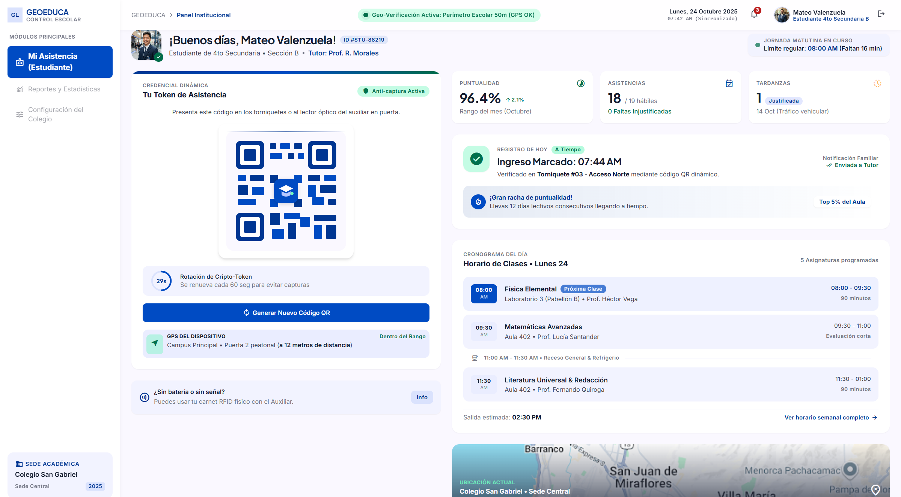 |
| UI-02 – Validación en vivo | 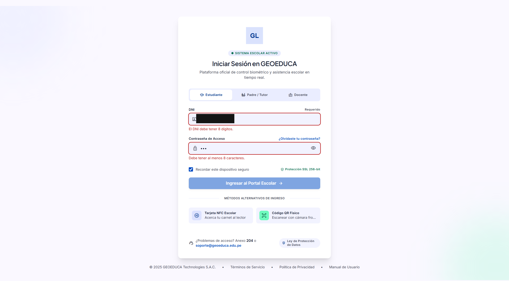 |
| UI-03 – Ruta protegida sin sesión | 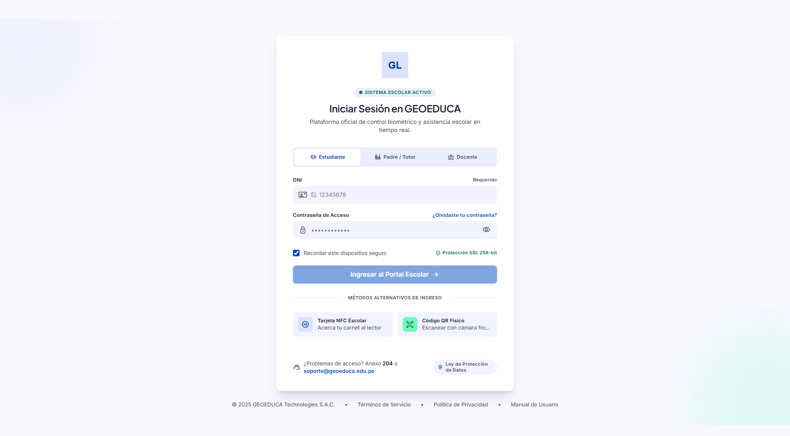 |
| UI-04 – Credencial incorrecta |  |
| UI-06 – Rol manipulado abre el panel auxiliar (**fallido**) | 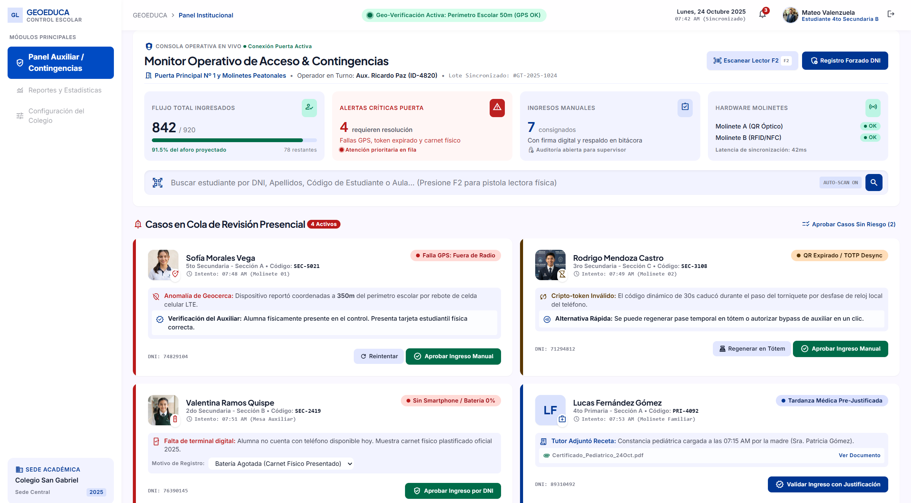 |
| UI-09 – Login de padre/tutor | 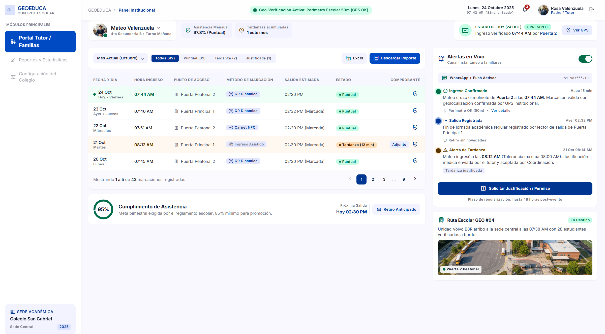 |
| UI-10 – Login de docente | 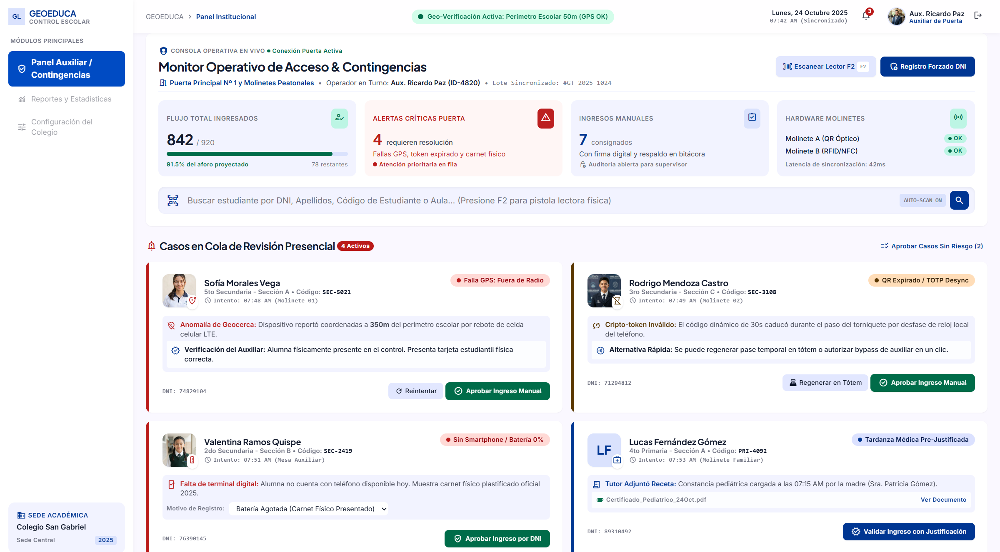 |
| UI-11 – Vista de 375 px del panel auxiliar | 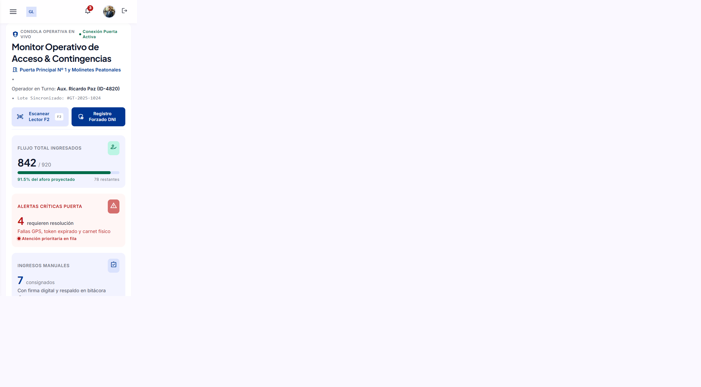 |
| UI-11 – Contenido recortado en 375 px (**fallido**; el encabezado repetido al pie es un artefacto de la captura) | 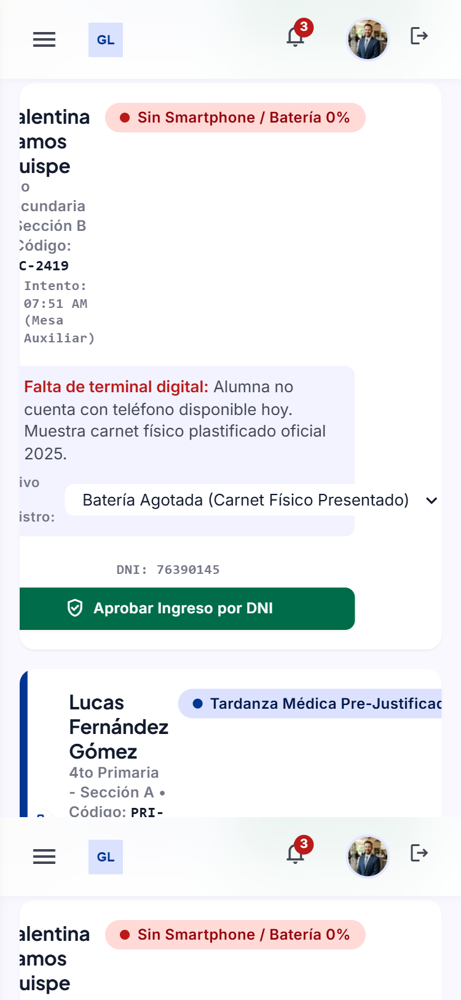 |
| UI-12 – Backend caído: mensaje técnico (**fallido**) | 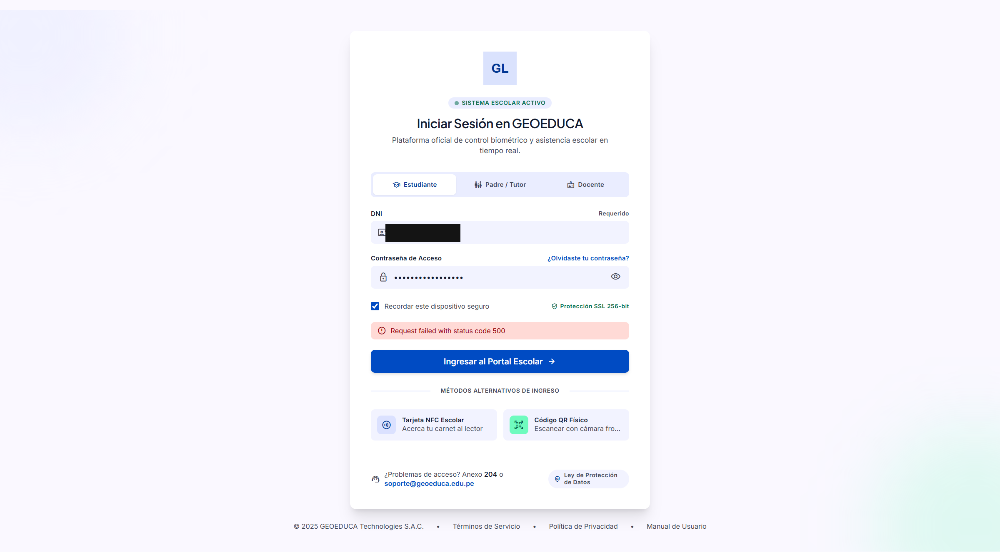 |

UI-05, UI-07 y UI-08 se evidenciaron con mediciones del navegador (`ui/mediciones-dom.json`), no con captura.

## 4.3 Resumen cuantitativo (Tabla 5)

| Indicador | Resultado |
|---|---:|
| Casos planificados | 50 |
| Casos ejecutados (aprobados + fallidos) | 46 |
| Casos aprobados | 30 |
| Casos fallidos | 16 |
| Casos bloqueados | 4 |
| Casos no ejecutados | 0 |
| **Porcentaje de aprobación** (30 / 46 × 100) | **65,2 %** |

| | Aprobado | Fallido | Bloqueado | Total |
|---|---:|---:|---:|---:|
| API | 23 | 11 | 4 | 38 |
| Interfaz | 7 | 5 | 0 | 12 |
| **Total** | **30** | **16** | **4** | **50** |

Los 4 casos bloqueados (B-01 a B-04) se informan aparte y **no entran en el denominador**, como indica la guía: la funcionalidad no existe y no puede evaluarse.
Por tipo (API): funcionales 6/6, validación de datos 9/9, funcional negativo 2/2, integración 3/4 y **seguridad 3/13**.

*Interpretación:* el sistema aprueba lo que implementa de forma básica (login, validaciones, contratos) y falla casi todo lo que exige seguridad. Un 65,2 % de aprobación no significa «dos tercios de calidad»:
los 16 fallos se concentran en seguridad (**11 de los 15** casos de seguridad fallan, entre API e interfaz) y en la simulación de la interfaz.

## 4.4 Incidencias detectadas

El detalle de cada incidencia (descripción, comportamiento observado, evidencia, impacto y prioridad) está en `REGISTRO-DE-INCIDENCIAS.md`. Ninguna está corregida.

| ID | Incidencia | Prioridad |
|---|---|---|
| INC-01 | Las rutas `/api/auth/me` y `/api/asistencia/*` no exigen autenticación | **Crítica** |
| INC-02 | No hay autorización por rol en el servidor (ni en el navegador: se salta editando `localStorage`) | **Crítica** |
| INC-03 | El token no se invalida al cerrar sesión | Alta |
| INC-04 | Sin límite de intentos de inicio de sesión | Alta |
| INC-05 | El QR no es dinámico | Alta |
| INC-06 | Geolocalización, notificaciones y persistencia no implementadas | Alta (alcance) |
| INC-16 | Dependencias con vulnerabilidades (1 aviso crítico de `laravel/framework`, 7 de `npm audit`) | Alta |
| INC-07 | `APP_DEBUG=true` expone trazas en un 404 | Media |
| INC-08 | Fecha y hora fijas marcadas como «Sincronizado» | Media |
| INC-11 | DNI como arreglo JSON provoca HTTP 500 (hallazgo de la automatización) | Media |
| INC-12 | SonarQube: posibles contraseñas fijas en `authService.js` | Media |
| INC-15 | SonarQube: 9 problemas de accesibilidad | Media |
| INC-09 | Cabeceras de seguridad ausentes y `X-Powered-By` | Baja |
| INC-10 | Sin `Accept`, un error de validación responde 302 | Baja |
| INC-13 | Contenido recortado en vista móvil de 375 px | Baja |
| INC-14 | Con el backend caído se muestra un mensaje técnico | Baja |

## 4.5 Análisis de los resultados

- **Comprobado:** cada caso de API guarda la petición enviada y la respuesta recibida (`api/TC-*.json`), por lo que los 11 fallos de API se pueden reproducir con peticiones HTTP simples.
- **Comprobado:** INC-02 se reprodujo también desde el navegador (UI-06): un usuario con rol de estudiante abre el «Panel Auxiliar» con datos de otros alumnos cambiando un valor en `localStorage`.
- **Interpretación:** los defectos críticos no son errores de programación sueltos, sino la **ausencia de una capa**: el `TODO` de `routes/api.php` reconoce que la protección con `auth:sanctum` aún no existe.
  Por eso un cambio estructural (autenticación y autorización reales) atacaría directamente 18 de los 27 fallos automatizados (INC-01 e INC-02); los demás requieren correcciones puntuales.
- **Limitación:** la interfaz de UI-11 solo se midió en el panel auxiliar, y UI-12 se probó con el proxy de Vite, no en un despliegue sin proxy.

---

# 5. Implementación y ejecución de las pruebas automatizadas

## 5.1 Selección de las pruebas y justificación

Se automatizaron **35 de los 38 casos manuales de API** (`automatizadas/trazabilidad-matriz-manual.csv`). La selección responde a los criterios de la guía:

| Criterio de la guía | Cómo se cumple en GEOEDUCA |
|---|---|
| Reglas de negocio definidas | Reglas de validación del login (DNI de 8 dígitos, contraseña de 8 a 128 caracteres, perfil válido) y de seguridad (401, 403, 429, 422) |
| Se ejecutan repetidamente | Cualquier cambio futuro de la API debe volver a pasar login, validaciones y seguridad |
| Datos de entrada y resultados verificables | Cada caso envía una petición con datos ficticios y comprueba estado HTTP, cuerpo y cabeceras |
| Importancia para el funcionamiento | El login y las rutas de asistencia son el núcleo de la API; la seguridad protege datos de menores |
| Resultado esperado claramente definido | El esperado de cada caso está fijado en la matriz manual (por ejemplo «401 Unauthorized»), lo que permite convertirlo en una aserción exacta |

**No se automatizaron:**

| Casos | Motivo |
|---|---|
| I-01 e I-02 (proxy de Vite) | Necesitan Vite en ejecución; la parte de la API (contrato del login) la cubre F-02 |
| S-09 (`X-Powered-By`) | La cabecera la añade el intérprete de PHP (`expose_php=1`), no Laravel, y no es observable en una prueba en proceso |
| Los 12 casos de interfaz (UI-01 a UI-12) | Requieren pruebas de frontend; Vitest 3.2.7 se descartó porque introducía 2 vulnerabilidades críticas y la versión corregida exige Vite 6 o superior (hoy 5.4.21) |

## 5.2 Herramienta seleccionada

**PHPUnit 11.5.57** con **Mockery 1.6.15**. PHPUnit es la herramienta de referencia de la guía para PHP y Laravel (Tabla 6). Se usa para pruebas de funcionalidad de la API (con el cliente HTTP de Laravel),
pruebas unitarias (`MockUserAuthenticator`, `AuthService` con Mockery, `DemoAccounts`) y pruebas de requisitos de seguridad. Configuración aislada en `backend/phpunit.xml`: `APP_ENV=testing`,
SQLite en memoria (no se usa), sesiones y caché en memoria, log nulo y una `APP_KEY` falsa solo para pruebas.

## 5.3 Casos de prueba automatizados

124 casos en 66 funciones y 18 clases (`automatizadas/resultados-por-prueba.csv`, `automatizadas/testdox-*.txt`). Cada clase lleva atributos `#[Group('ID')]` con el identificador del caso manual.

| Suite | Clase de prueba | Casos manuales que cubre |
|---|---|---|
| `Caracterizacion` | `SaludTest` | F-01 |
| | `LoginPerfilesTest` | F-02 a F-04 |
| | `LoginRechazoTest` | N-01 a N-03 |
| | `LoginValidacionTest` | V-01 a V-06 |
| | `AsistenciaContratoTest`, `AsistenciaValidacionTest` | F-05, F-06, B-04, V-07 a V-09 |
| | `ContratoRutasTest` | B-01 a B-03 |
| | `CorsTest` | I-03, I-04 |
| | `ComportamientoActualInseguroTest` | S-01 a S-08, S-11 y AUTO-01 (fotografía de los defectos) |
| | `MockUserAuthenticatorTest`, `AuthServiceTest`, `DemoAccountsTest` | Unidad |
| `RequisitosSeguridad` | `AutenticacionRequeridaTest` | S-01 a S-04 |
| | `AutorizacionPorRolTest` | S-05 |
| | `SesionYLogoutTest` | S-06 |
| | `LimiteIntentosLoginTest` | S-08 |
| | `EndurecimientoHttpTest` | S-10, S-11, I-05 |
| | `EntradasHostilesTest` | S-07, AUTO-01 |

Distinción clave: `Caracterizacion` fija lo que el sistema hace **hoy**, incluidos sus defectos, y debe aprobar siempre; `RequisitosSeguridad` comprueba lo que un sistema **seguro** debe hacer y falla mientras exista el defecto.
Un 100 % en `Caracterizacion` **no significa que el sistema sea correcto**. No se usó `skip`, `todo` ni aserciones triviales, y las expectativas no se modificaron para ocultar fallos.

## 5.4 Código fuente (fragmentos)

El código completo está en `backend/tests/` (publicado en el commit `b326574`). Dos fragmentos representativos:

Requisito de seguridad que falla hoy (`backend/tests/Seguridad/AutorizacionPorRolTest.php`):

```php
#[Group('requisito-incumplido')]
#[Group('S-05')]
final class AutorizacionPorRolTest extends TestCase
{
    use IniciaSesion;

    public static function usosIndebidos(): array
    {
        return [
            'estudiante → GET auxiliar/casos' => ['student', 'GET', '/api/asistencia/auxiliar/casos', []],
            'padre → POST auxiliar/aprobar' => ['parent', 'POST', '/api/asistencia/auxiliar/aprobar', Cargas::aprobacion()],
            // ... 6 combinaciones en total
        ];
    }

    #[DataProvider('usosIndebidos')]
    #[TestDox('Un perfil autenticado que usa la ruta de otro perfil recibe 403 Forbidden')]
    public function test_rol_incorrecto_recibe_403(string $perfil, string $metodo, string $uri, array $carga): void
    {
        $token = $this->tokenDe($perfil);

        $this->withToken($token)->json($metodo, $uri, $carga)->assertForbidden();
    }
}
```

Prueba de validación que aprueba (`backend/tests/Caracterizacion/Feature/LoginValidacionTest.php`, extracto del *data provider*; contiene solo los campos que cambian, para que PHPUnit nunca imprima la contraseña de demostración):

```php
'V-01 DNI de 7 dígitos'            => ['base', ['identifier' => '<DNI-DE-7-DIGITOS>'], ['identifier']],
'V-02 contraseña de 3 caracteres'  => ['base', ['password' => 'abc'], ['password']],
'V-03 perfil inexistente (admin)'  => ['base', ['role' => 'admin'], ['role']],
'V-04 formulario vacío'            => ['vacio', [], ['identifier', 'password', 'role']],
```

## 5.5 Comandos de ejecución

```powershell
cd backend
composer dump-autoload                                   # solo la primera vez (mapeo Tests\ en composer.json)
php vendor/bin/phpunit --testsuite Caracterizacion       # debe aprobar 89/89
php vendor/bin/phpunit --testsuite RequisitosSeguridad   # hoy: 27 fallos de 35
php vendor/bin/phpunit --group S-05                      # una prueba por ID de la matriz manual
php vendor/bin/phpunit --group requisito-incumplido      # solo los requisitos que fallan
```

`php artisan test` no está disponible (no está instalado `nunomaduro/collision`); se usa `vendor/bin/phpunit`.

## 5.6 Resultados de la ejecución (Tabla 7)

| Indicador | Resultado |
|---|---:|
| Total de pruebas automatizadas ejecutadas | 124 |
| Pruebas aprobadas | 97 |
| Pruebas fallidas | 27 |
| Pruebas omitidas o no ejecutadas | 0 |
| **Porcentaje de aprobación** (97 / 124 × 100) | **78,2 %** |
| Tiempo de ejecución | 2,98 s (suma de JUnit: 2,05 s + 0,93 s) |

| Suite | Pruebas | Aserciones | Aprobadas | Fallidas | Aprobación | Línea `Time:` de PHPUnit |
|---|---:|---:|---:|---:|---:|---:|
| `Caracterizacion` | 89 | 305 | 89 | 0 | **100 %** | 2,110 s |
| `RequisitosSeguridad` | 35 | 74 | 8 | 27 | **22,9 %** | 0,963 s |
| **Total** | **124** | 379 | **97** | **27** | **78,2 %** | 3,073 s |

*Interpretación:* el 78,2 % global **no mide la calidad del sistema**, porque mezcla una suite que describe lo que el sistema hace hoy con otra que mide los requisitos seguros. La cifra relevante frente a los requisitos
es la de `RequisitosSeguridad`: 22,9 %.

**Segunda ejecución (2026-10-28, 00:05 hora local).** Se repitieron ambas suites sin modificar ninguna prueba ni el código, para tener un registro fechado adicional
(`automatizadas/ejecucion-2026-10-28/`). Los resultados fueron **idénticos**: `OK (89 tests, 305 assertions)` y `Tests: 35, Assertions: 74, Failures: 27`, con los mismos 27 nombres de prueba fallida (0 diferencias).
Solo cambió el tiempo (`Time:` 3,167 s y 1,749 s). Se conservan ambos registros (`automatizadas/resumen-comparativo-ejecuciones.json`). No hubo cambios persistentes.

**Cobertura:** no disponible. PHPUnit informa `No code coverage driver available` (`automatizadas/cobertura-no-disponible.txt`): el PHP del equipo no tiene Xdebug ni PCOV y no se instaló ninguno.

## 5.7 Análisis de los 27 fallos

Todos están en `RequisitosSeguridad`; **ninguno está corregido**. Cada uno corresponde a un defecto real, no a una prueba defectuosa.

| Requisito incumplido | Fallos | Resultado real | Incidencia | Casos manuales |
|---|---:|---|---|---|
| Las rutas protegidas exigen autenticación (sin credenciales) | 6 | Esperaba 401, recibió 200 | INC-01 | S-01, S-02, S-03 |
| Un token inventado se rechaza | 6 | Esperaba 401, recibió 200 | INC-01 | S-04 |
| Un perfil no usa rutas de otro perfil | 6 | Esperaba 403, recibió 200 | INC-02 | S-05 |
| El token queda inválido tras cerrar sesión; un token válido identifica al usuario | 3 | Recibió 200; `user = null` con token válido | INC-03 | S-06 |
| Límite de intentos de login | 1 | 12 intentos fallidos, todos 401, ningún 429 | INC-04 | S-08 |
| Cabecera `X-Content-Type-Options: nosniff` | 1 | Cabecera ausente | INC-09 | S-10 |
| Un 404 de API no filtra traza con la configuración por defecto | 1 | Con `APP_DEBUG=true` expone `trace, file, line, exception` | INC-07 | S-11 |
| Un error de validación sin `Accept` responde 422 JSON | 1 | Recibió 302 | INC-10 | I-05 |
| Un DNI como arreglo u objeto JSON no provoca error 500 | 2 | HTTP 500 (`Array to string conversion`, `LoginRequest.php:22`) | INC-11 | AUTO-01 (nuevo) |
| **Total** | **27** | | | |

Aprueban 8 requisitos de la misma suite: las 8 entradas hostiles de S-07 (inyección SQL en DNI, contraseña y perfil; script HTML; contraseña y perfil como arreglo) se rechazan con 401 o 422, sin token ni detalles internos.
**AUTO-01 es un hallazgo nuevo de la automatización**: `LoginRequest::prepareForValidation()` convierte el DNI con `(string)` y, si llega un arreglo, el servidor responde 500 en vez de 422.

## 5.8 Capturas de la ejecución

> **PENDIENTE DE INTERVENCIÓN MANUAL.** La guía exige capturas de pantalla de la ejecución de PHPUnit. Con las herramientas disponibles no se puede capturar la terminal, por lo que se conservan el comando,
> la fecha, el código de salida y la salida completa de ambas ejecuciones (`automatizadas/salida-*.txt` y `automatizadas/ejecucion-2026-10-28/`). Insertar aquí dos capturas tomadas por el estudiante (ver el anexo C):
>
> 1. `php vendor/bin/phpunit --testsuite Caracterizacion` mostrando `OK (89 tests, 305 assertions)`.
> 2. `php vendor/bin/phpunit --testsuite RequisitosSeguridad` mostrando `Tests: 35, Assertions: 74, Failures: 27`.

---

# 6. Comparación entre pruebas manuales y automatizadas

Versión completa en `COMPARACION-MANUAL-AUTOMATIZADA.md`. Se responde a los seis aspectos de la guía.

**1. Funcionalidades verificadas manualmente.** 50 casos (38 de API y 12 de interfaz): login de los tres perfiles, validaciones, seguridad, integración, la interfaz (fecha, QR, cierre de sesión, móvil, backend caído)
y la ausencia de las funcionalidades de QR, geolocalización, notificaciones y persistencia.

**2. Funcionalidades verificadas mediante automatización.** 124 pruebas PHPUnit que cubren 35 de los 38 casos de API, más una prueba nueva (AUTO-01) y las pruebas unitarias de `MockUserAuthenticator`, `AuthService` y `DemoAccounts`. No cubren la interfaz.

**3. Coincidencias o diferencias entre los resultados.** Se comparó por programa el resultado de cada caso manual con el de su prueba automatizada:

| Resultado manual | Resultado automatizado | Casos | ¿Coinciden? |
|---|---|---:|---|
| Aprobado | La prueba aprueba | 21 | Sí |
| Fallido | El requisito falla | 10 | Sí |
| Bloqueado | La caracterización de la ausencia aprueba | 4 | Sí |
| **Total comparable** | | **35** | **35 de 35, sin discrepancias** |

**4. Defectos detectados por cada modalidad.**

| Defecto | Manual / API | Interfaz manual | PHPUnit | SonarQube |
|---|:---:|:---:|:---:|:---:|
| Sin autenticación, sin autorización, token vigente tras logout, sin límite de intentos, traza con debug, cabecera `nosniff`, sin `Accept` | Sí | Parcial (UI-06) | Sí (25 fallos) | No |
| **DNI como arreglo → HTTP 500 (INC-11)** | **No** | — | **Sí (2)** | No |
| QR no dinámico, fecha fija, contenido recortado en móvil, mensaje técnico sin backend | — | Sí | No | No |
| Contraseñas fijas en el frontend (INC-12) | Auditoría estática | — | No | **Sí (2)** |
| Accesibilidad de formularios y componentes (INC-15) | No | No | No | **Sí (9)** |

Cada técnica encontró algo que las otras no vieron.

**5. Ventajas y limitaciones.** Las pruebas **manuales** ven lo que ve el usuario y cubren la interfaz y la unión entre procesos, pero cada repetición exige tiempo humano y el esfuerzo manual no se cronometró,
por lo que no se da una cifra de ahorro. Las **automatizadas** se repiten en segundos y de forma idéntica (la suite tarda 2,98 s y dio los mismos 27 fallos en una segunda ejecución), fijan cada requisito
como una prueba que pasa a aprobada al corregir el defecto y probaron entradas hostiles que no se habían pensado (AUTO-01); pero solo ven lo que el código en proceso expone (no vieron `X-Powered-By` ni el proxy de Vite),
no cubren la interfaz y no miden cobertura.

**6. Posibilidades de ampliar la automatización** *(propuestas, no implementadas)*: pruebas de frontend con Vitest tras actualizar a Vite 6; pruebas de extremo a extremo con Playwright (UI-01, UI-09 a UI-12);
medición de cobertura con PCOV o Xdebug e importación en SonarQube; pruebas de accesibilidad que repliquen las 9 incidencias de Sonar; integración continua con PHPUnit, SonarQube y las auditorías de dependencias.

---

# 7. Análisis de calidad del código con SonarQube

## 7.1 Preparación y ejecución del análisis

| Aspecto | Detalle |
|---|---|
| Servidor | SonarQube Community Build 26.10.0.133078 en Docker (`sonar/docker-compose.yml`), con PostgreSQL 16.15; solo accesible desde `127.0.0.1:9000`; sin telemetría |
| Escáner | SonarScanner CLI 8.1.0.6389 (imagen `sonar-scanner-cli:12.3.0.4285_8.1.0`, Java 21.0.12.1) |
| Plugins y perfil | PHP 4.1.0, JavaScript 14.0.0; perfil de calidad «Sonar way core» |
| Proyecto | Clave `geoeduca-pruebas-calidad`, nombre «GEOEDUCA - Pruebas y calidad» |
| Configuración | `sonar-project.properties`: fuentes `backend/app`, `backend/routes`, `backend/config`, `backend/bootstrap` y `frontend/src`; pruebas `backend/tests`; exclusiones de `vendor`, `node_modules`, `dist`, `storage`, caché y `docs/01-guia-pruebas-calidad`; informe JUnit de PHPUnit importado |
| Ejecución | El escáner indexó 70 archivos (48 de código y 22 de pruebas) y terminó con `ANALYSIS SUCCESSFUL` (`sonarqube/salida-escaner.txt`) |
| Análisis vigente | `bc4c4544`, tarea `a8f898fa` en estado `SUCCESS`, commit `b326574`, 2026-10-27 a las 23:06 (hora local); es el tercero de tres sobre el mismo proyecto, y el primero y el segundo están purgados |
| Seguridad | Los tokens se introdujeron por entrada oculta y no se almacenan en ningún archivo |
| Panel | Capturas reales en la sección 7.5 |

## 7.2 Resultados (Tabla 8)

| Métrica | Resultado obtenido | Interpretación |
|---|---|---|
| **Quality Gate** | **Aprobado** («Sonar way», sin modificar) | El código nuevo no introdujo incidencias. No indica ausencia de defectos |
| **Bugs** | **0** | No se detectaron errores de lógica tipo *bug*; no significa que no existan (16 casos manuales y 27 pruebas fallidas que Sonar no ve) |
| **Vulnerabilities** | **2** (`javascript:S2068`) | Posibles contraseñas fijas en `authService.js` (líneas 44 y 46): cuentas de respaldo sin conexión que viajan en el paquete del navegador |
| **Code Smells** | **9** | Todos de accesibilidad en el frontend: 6 × `S6853` (etiquetas sin control asociado) y 3 × `S6848` (elementos interactivos no nativos) |
| **Coverage** | **No medida** | Sin informe de cobertura. El «0,0 %» del panel es automático (sensor *Zero Coverage*) y **no es una medición** |
| **Duplicated Lines (%)** | **0,0 %** | Sin duplicación significativa (0 bloques sobre 3.594 líneas) |
| **Maintainability Rating** | **A** | Deuda técnica baja: 45 min (modelo clásico) o 15 min (MQR) |
| **Reliability Rating** | **A** (clásico) / **C** (MQR, el del panel) | Sin *bugs*, pero 9 incidencias de accesibilidad de impacto medio |
| **Security Rating** | **C** | Las 2 vulnerabilidades de impacto medio; 0 *Security Hotspots* |

Otras métricas (`sonarqube/metricas.json`): 3.242 líneas de código (CSS 18, JavaScript 2.718, PHP 506), 3.594 líneas, 48 archivos, complejidad ciclomática 333 y cognitiva 128, y los resultados de PHPUnit importados (124 pruebas, 27 fallidas, tasa de éxito 78,2 %).
SonarQube trabaja en **modo MQR**: el panel y las métricas clásicas clasifican los mismos 11 hallazgos con dos criterios, y por eso la fiabilidad aparece como A y como C (`sonarqube/metricas-mqr.json`).

## 7.3 Quality Gate

El gate «Sonar way» define **cuatro condiciones sobre el código nuevo**: 0 incidencias, hotspots revisados, cobertura ≥ 80 % y duplicación ≤ 3 %. La API devolvió una sola condición evaluada, `new_violations` con valor 0 (aprobada); las otras tres no
tuvieron valor sobre el código nuevo («not enough lines to compute coverage», duplicación «Not computed»). **El gate no se modificó.** El código nuevo se mide desde la versión anterior y no cambió entre análisis.

**Quality Gate aprobado no equivale a ausencia de vulnerabilidades ni a pruebas aprobadas:** coexisten el gate aprobado, 2 vulnerabilidades, 9 incidencias de accesibilidad, 27 pruebas fallidas y cobertura no medida.

## 7.4 Incidencias y archivos afectados (11)

| Archivo | Incidencias | Regla | Líneas |
|---|---:|---|---|
| `frontend/src/pages/DashboardPadre.jsx` | 4 | `S6853` (etiquetas de formulario) | 483, 691, 722, 750 |
| `frontend/src/services/authService.js` | 2 | `S2068` (posible contraseña fija) | 44, 46 |
| `frontend/src/pages/DashboardAuxiliar.jsx` | 2 | `S6853` | 589, 602 |
| `frontend/src/components/Modal.jsx` | 2 | `S6848` (elementos no nativos) | 15, 19 |
| `frontend/src/components/Sidebar.jsx` | 1 | `S6848` | 22 |

Todas en el frontend, ninguna en PHP; esfuerzo total estimado 1 h 45 min. 0 Security Hotspots (la API de hotspots está deprecada: la recopilación inicial falló con HTTP 400 por usar el parámetro `projectKey`,
renombrado a `project` en SonarQube 10.2; ver `sonarqube/diagnostico-hotspots-http400.json`).

## 7.5 Capturas del panel

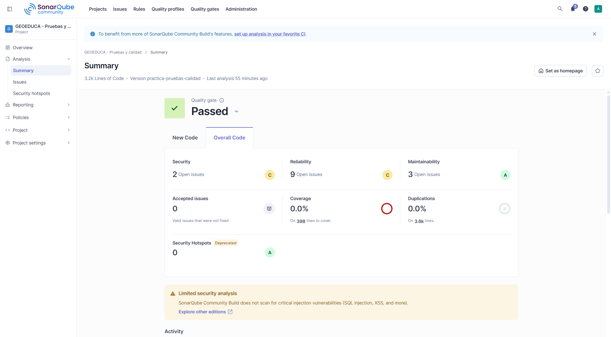

*Figura 7.1 – Panel principal del proyecto (código global).*

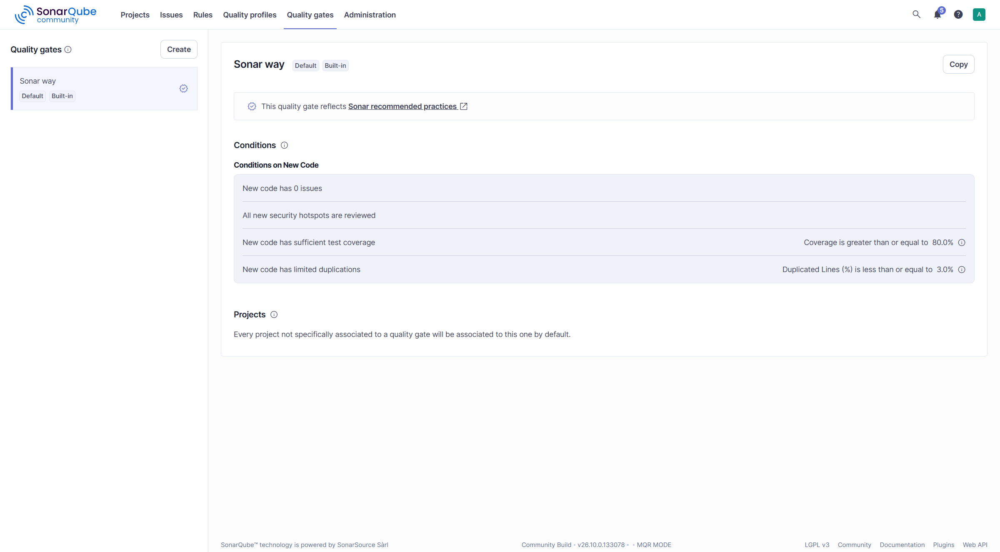

*Figura 7.2 – Condiciones del Quality Gate «Sonar way» (solo lectura).*

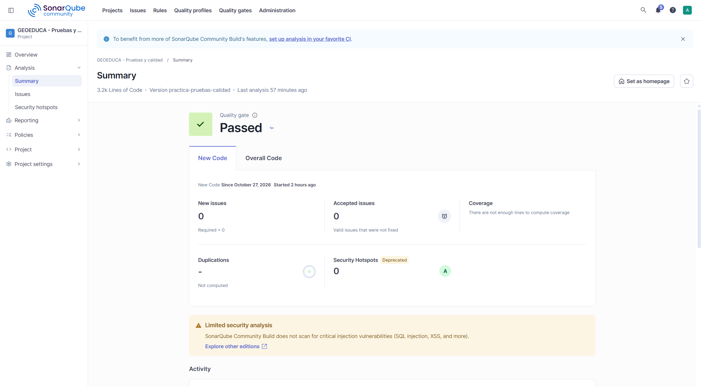

*Figura 7.3 – Resumen del código nuevo.*

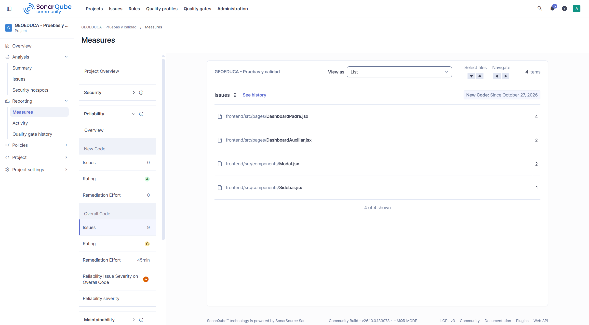

*Figura 7.4 – Incidencias de fiabilidad por archivo (calificación C, 45 min).*

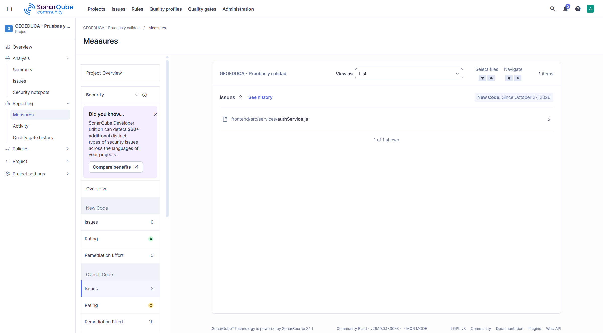

*Figura 7.5 – Incidencias de seguridad en `authService.js` (calificación C, 1 h).*

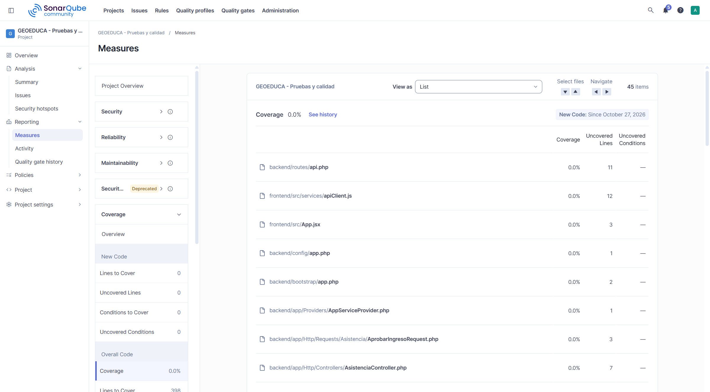

*Figura 7.6 – Cobertura: el 0,0 % es automático, no una medición (incluso `backend/routes/api.php`, que las pruebas ejecutan, aparece con 11 líneas «sin cubrir»).*

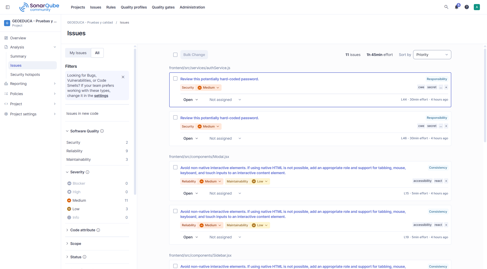

*Figura 7.7 – Lista de las 11 incidencias.*

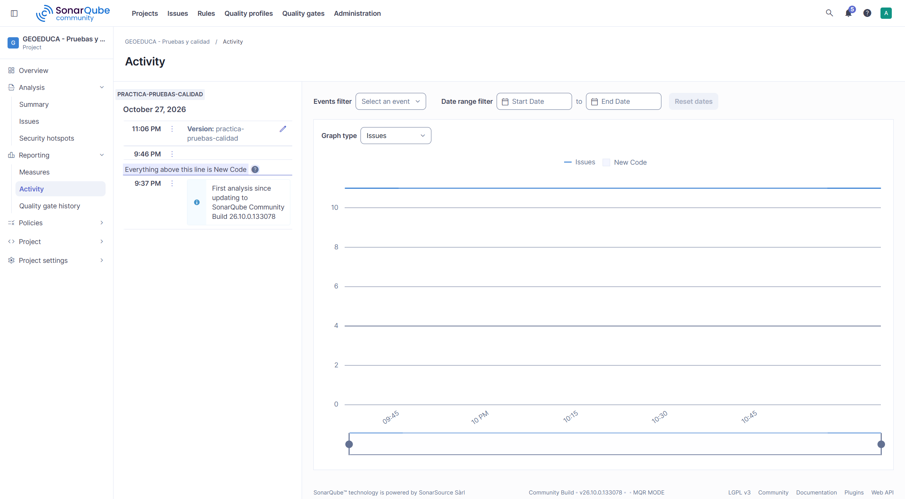

*Figura 7.8 – Historial: tres análisis el 2026-10-27; el vigente es el de las 23:06.*

También están `sonarqube/capturas/SQ-04_medidas-del-proyecto.png` (gráfico de riesgo).

## 7.6 Interpretación (preguntas de 4.3 de la guía)

1. **¿Quality Gate aprobado o fallido?** Aprobado, con una sola condición evaluada (sin incidencias nuevas).
2. **¿Qué problemas de calidad se identificaron?** 11 incidencias, todas en el frontend: 2 posibles contraseñas fijas y 9 de accesibilidad.
3. **¿Cuántos *bugs*, vulnerabilidades y *code smells*?** 0, 2 y 9.
4. **¿Qué cobertura se obtuvo?** No medida; el 0,0 % del panel no es una medición.
5. **¿Qué partes requieren mayor atención?** `DashboardPadre.jsx` (4 incidencias), `authService.js` (2 vulnerabilidades), `DashboardAuxiliar.jsx` (2), `Modal.jsx` (2) y `Sidebar.jsx` (1).
   *Interpretación:* el backend no tiene incidencias de Sonar, pero concentra los defectos de seguridad reales, que Sonar no ve porque Community Build no analiza el flujo de datos de PHP.
6. **¿Qué corregir primero y por qué?** Primero INC-01 e INC-02 (cualquier cliente accede a datos de menores), después INC-16 (aviso crítico de `laravel/framework`), después INC-12 (contraseñas fijas en el paquete del navegador) e INC-15
   (accesibilidad: 5 min por incidencia, 45 min las nueve).
7. **Relación entre las pruebas y el análisis estático:** son complementarios y casi disjuntos: ninguno de los 11 hallazgos de Sonar coincide con los 16 casos manuales fallidos ni con los 27 fallos de PHPUnit, y Sonar no detectó
   ninguna de las 8 incidencias que reproduce PHPUnit. Sonar encontró lo que las pruebas dinámicas no ejercitan (accesibilidad); las pruebas, lo que Sonar no ve (comportamiento y seguridad).
8. **Mejoras concretas:** lista priorizada en 7.7.

## 7.7 Mejoras priorizadas (propuestas, no implementadas)

| N.º | Mejora | Incidencia | Prioridad |
|---:|---|---|---|
| 1 | Exigir autenticación real en `/api/auth/me` y `/api/asistencia/*` (Sanctum ya está instalado) | INC-01 | Crítica |
| 2 | Autorizar por rol en el servidor | INC-02 | Crítica |
| 3 | Actualizar `laravel/framework` y evaluar Vite 6 | INC-16 | Alta |
| 4 | Invalidar el token al cerrar sesión | INC-03 | Alta |
| 5 | Limitar los intentos de login | INC-04 | Alta |
| 6 | Quitar del paquete del frontend las cuentas de respaldo con contraseñas fijas | INC-12 | Media |
| 7 | Validar el tipo del DNI antes del `(string)` en `LoginRequest.php:22` | INC-11 | Media |
| 8 | Desplegar con `APP_DEBUG=false` | INC-07 | Media |
| 9 | Corregir las 9 incidencias de accesibilidad (`htmlFor`/`id`, elementos nativos) | INC-15 | Media |
| 10 | Mostrar fecha y hora reales | INC-08 | Media |
| 11 | Implementar QR dinámico, geolocalización, notificaciones y persistencia | INC-05, INC-06 | Alta (el mayor esfuerzo, al final) |
| 12 | Cabeceras de seguridad y `Accept` | INC-09, INC-10 | Baja |
| 13 | Mensaje claro de falta de conexión | INC-14 | Baja |
| 14 | Corregir el recorte en 375 px | INC-13 | Baja |

Justificación, esfuerzo y verificación de cada una, y mejoras de proceso (cobertura, frontend, integración continua, ajuste del gate), en `PROPUESTAS-DE-MEJORA.md`.

## 7.8 Limitaciones del análisis

1. Cobertura no medida.
2. Community Build no incluye análisis de flujo de datos para PHP: no ve la falta de autenticación ni de autorización (el panel lo avisa: «Limited security analysis»).
3. El análisis de dependencias se omitió; las vulnerabilidades de dependencias provienen de `composer audit` y `npm audit` (`dependencias/`).
4. Solo se analiza la rama principal y los dos primeros análisis fueron purgados.
5. El archivo `sonarqube/coherencia-del-analisis.json` marca `todoCoincide: false` por un defecto de lógica del script, que comparó con archivos del análisis anterior. Se conserva sin modificar y se respalda la coherencia con
   `sonarqube/verificacion-coherencia-independiente.json` (13 de 13 comprobaciones) y las capturas del panel (`sonarqube/NOTA-COHERENCIA.md`).
6. Las fechas de los archivos JSON de Sonar están en UTC; las capturas, en hora local (UTC-5).

---

# 8. Conclusiones

1. **El prototipo cumple lo que implementa de forma básica**: el login por perfil, las validaciones de datos y los contratos de la API se comportan como se espera (6/6 funcionales, 9/9 de validación y 2/2 negativos aprobaron en API).
2. **No cumple los requisitos de seguridad esperados**: faltan autenticación y autorización en el servidor, invalidación de sesión y límite de intentos. Se demostró de forma independiente con 16 casos manuales fallidos
   y 27 pruebas automatizadas fallidas, con trazabilidad entre ambas (35 de 35 casos comparables coinciden).
3. **Las funcionalidades centrales del producto (QR dinámico, geolocalización, notificaciones y persistencia) no existen**; la interfaz las simula, y muestra una fecha fija «Sincronizada». Los resultados describen un prototipo de interfaz, no un sistema funcional.
4. **Resultado de la ejecución manual:** 50 casos planificados, 46 ejecutados, 30 aprobados, 16 fallidos y 4 bloqueados, con una aprobación del 65,2 % sobre los ejecutados. **Resultado automatizado:** 124 pruebas, 97 aprobadas y
   27 fallidas (78,2 % global; 100 % en caracterización y 22,9 % en requisitos de seguridad).
5. **Nivel de automatización:** 35 de los 38 casos de API (92,1 %) y ninguno de los 12 de interfaz; con una ampliación razonable (Vitest, Playwright, cobertura e integración continua) se cubriría el resto.
6. **La automatización aportó un hallazgo que las pruebas manuales no cubrieron** (AUTO-01, HTTP 500 con un DNI en forma de arreglo) y deja los 27 requisitos como un listado medible de lo que falta corregir.
7. **SonarQube encontró 2 vulnerabilidades y 9 problemas de accesibilidad, todos en el frontend y ninguno en el backend.** El Quality Gate está aprobado, pero eso **no debe interpretarse como señal de calidad suficiente**: solo evalúa el código nuevo
   y coexiste con 27 pruebas fallidas. El panel muestra una fiabilidad C y una seguridad C.
8. **Las tres técnicas son complementarias**: ningún hallazgo de Sonar coincide con los fallos dinámicos, y la automatización encontró lo que la inspección manual no consideró. Combinarlas dio una imagen más completa que cualquiera por separado.
9. **Se detectaron 16 incidencias** (2 críticas, 5 altas, 5 medias y 4 bajas). Ninguna se corrigió, por las restricciones de la práctica; se proponen 14 mejoras priorizadas (`PROPUESTAS-DE-MEJORA.md`).
   La más importante es conectar autenticación y autorización reales, que atacaría directamente 18 de los 27 fallos automatizados.
10. **Limitaciones:** cobertura no medida; frontend sin pruebas automatizadas (Vitest se descartó por vulnerabilidades); Sonar Community Build sin análisis de flujo de datos; capturas de PHPUnit pendientes de tomarse manualmente.

---

# 9. Evidencias y anexos

## Anexo A – Índice de evidencias

| Evidencia | Ruta |
|---|---|
| Guía oficial del profesor | No publicada (el DOCX original permanece en el archivo académico privado) |
| Plan de pruebas | `PLAN-DE-PRUEBAS.md` |
| Matrices y resultados manuales de API | `api/matriz-resultados-api.md`, `api/resultados-api.json`, `api/resumen-api.json`, `api/TC-*.json` (38), `api/route-list.json`; script `ejecutar-pruebas-api.ps1` |
| Matriz y evidencias de interfaz | `matriz-resultados-ui.md`, `ui/*.png` (10 capturas), `ui/mediciones-dom.json`, `ui/mediciones-dom-ui09-ui12.json` |
| Registro de incidencias | `REGISTRO-DE-INCIDENCIAS.md` |
| Código de las pruebas automatizadas | `backend/tests/` (18 clases y 4 de apoyo), `backend/phpunit.xml` |
| Resultados de PHPUnit | `automatizadas/` (`junit-*.xml`, `testdox-*.txt`, `salida-*.txt`, `resultados-por-prueba.csv`, `trazabilidad-matriz-manual.csv`, `resumen-automatizadas.json`, `resumen-comparativo-ejecuciones.json`) y `automatizadas/ejecucion-2026-10-28/` |
| Comparación manual / automatizada | `COMPARACION-MANUAL-AUTOMATIZADA.md` |
| Análisis de SonarQube | `sonarqube/` (`metricas.json`, `metricas-mqr.json`, `quality-gate.json`, `incidencias.json`, `hotspots.json`, `ce-task.json`, `resumen-sonarqube.json`, `verificacion-pruebas-phpunit.json`, `salida-escaner.txt`) |
| Capturas del panel de SonarQube | `sonarqube/capturas/SQ-01` a `SQ-09` |
| Interpretación y resumen académico de Sonar | `sonarqube/INTERPRETACION-METRICAS.md`, `sonarqube/RESUMEN-ACADEMICO.md` |
| Coherencia de las evidencias de Sonar | `sonarqube/verificacion-coherencia-independiente.json`, `sonarqube/NOTA-COHERENCIA.md` |
| Configuración reproducible de Sonar | No publicada (`sonar/` y `sonar-project.properties` permanecen en el archivo académico privado). Resultados públicos: `sonarqube/` |
| Auditoría de dependencias | `dependencias/composer-audit.json`, `dependencias/npm-audit.json` |
| Mejoras propuestas | `PROPUESTAS-DE-MEJORA.md` |
| Cumplimiento de la guía | `MATRIZ-CUMPLIMIENTO-Y-PENDIENTES.md` |

## Anexo B – Cómo reproducir

```powershell
# Pruebas manuales de API (con ambos servidores activos y las tres variables de entorno definidas)
powershell -ExecutionPolicy Bypass -File docs\01-guia-pruebas-calidad\ejecutar-pruebas-api.ps1

# Pruebas automatizadas
cd backend
php vendor/bin/phpunit --testsuite Caracterizacion
php vendor/bin/phpunit --testsuite RequisitosSeguridad

# Análisis estático: los scripts Docker de SonarQube no se publican.
# Los resultados ya recolectados están en docs/01-guia-pruebas-calidad/sonarqube/
```

## Anexo C – Actividades pendientes de intervención manual

| Pendiente | Motivo | Cómo resolverlo |
|---|---|---|
| Capturas de PHPUnit (sección 5.8) | Las herramientas disponibles no capturan la terminal | Ejecutar las dos suites en una terminal y tomar captura de cada una, con el comando y el resultado a la vista |
| Datos de la portada | Son personales o institucionales | Completar los campos **[COMPLETAR]** |
| Redacción oficial del objetivo del proyecto (2.1) | El repositorio no tiene un documento de objetivos | Confirmar o ajustar el texto |
| Formato final del informe (Word o PDF) | La guía no lo especifica | Confirmar con el docente; el Markdown está preparado para conversión |
| Revocar los tokens de SonarQube | Es una acción en la cuenta del usuario | *My Account → Security* |
| Commit y publicación de los documentos nuevos | Requiere autorización explícita; no se hizo ninguno | Revisar y autorizar |

## Anexo D – Verificación de datos sensibles

Se buscó en `docs/`, `sonar/` y `sonar-project.properties` (excluyendo `sonar/.env` y el almacén de certificados) tokens, contraseñas de demostración, tokens `mock-…`, rutas personales y correos: **0 coincidencias**.
El patrón genérico `password=` dio 7 coincidencias, todas inofensivas: 3 contraseñas **incorrectas** de prueba del script, 2 referencias a la variable de entorno `SONAR_DB_PASSWORD` y 2 con `changeit`, la contraseña pública por defecto
del almacén de certificados de Java. En las capturas de la interfaz el campo de contraseña aparece enmascarado.
La única credencial presente es el DNI de demostración `<DNI-DEMO-ESTUDIANTE>`, cuyo uso se autorizó expresamente.
