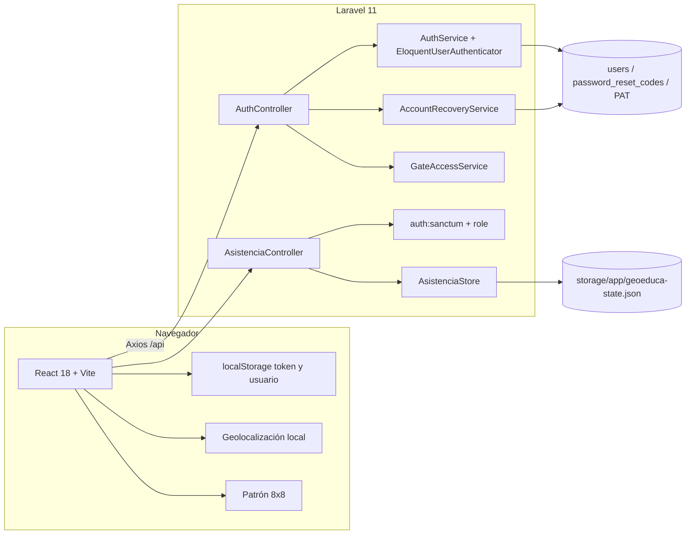
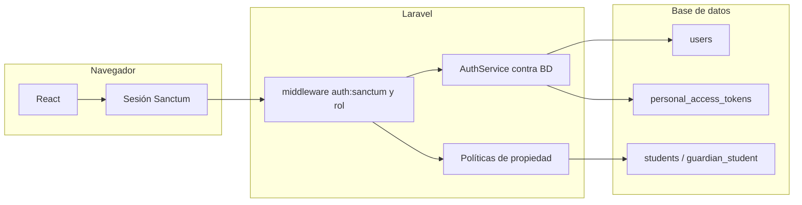

# Arquitectura

## Hoy (F1.3)

Flujos:

1. Login: `POST /api/auth/login` busca `(dni, role)` en `users`, comprueba el hash y emite un token Sanctum. No hay fallback a `DemoAccounts`.
2. Asistencia: el controlador lee el token, pide el actor al almacén y, si el rol coincide, muta el JSON y devuelve un `panel`.
3. Justificación: exige `child_id` y comprueba que el estudiante esté a cargo del tutor.
4. Frontend: el proxy de Vite reenvía `/api` a Laravel. CORS permite `localhost:5173` y `127.0.0.1:5173`.

F1.3: el login usa `users` + Sanctum. El carnet no emite sesión. La recuperación usa `password_reset_codes` hasheados. Las sesiones nuevas no van al JSON. La asistencia **sí** sigue en `AsistenciaStore`. Colas y correo no existen.

## Destino de F1 (persistencia + autenticación/autorización)

Las tablas de F1.1 ya existen. Sanctum y `role:` cubren login y autorización. `AsistenciaStore` se retira cuando se migre el historial (M4). Las pruebas de caracterización siguen fotografiando el JSON de asistencia.

## Límites de confianza actuales

| Superficie | Quién confía | Riesgo |
|---|---|---|
| Token en `localStorage` | El frontend | XSS lo lee |
| Rol en el navegador | `ProtectedRoute` | Se puede editar; el API ya no se deja engañar en asistencia |
| JSON único | Asistencia | Un archivo = historial y bitácora del prototipo; ya no guarda sesiones ni códigos |
| Cuentas de demostración | Seed local | Solo con `GEO_SEED_PROTOTYPE`; el login no lee `DemoAccounts` |
