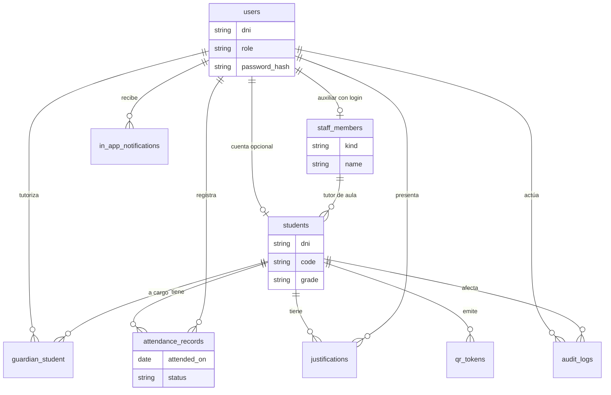

# Modelo de datos (F1.1)

Rama: `feature/f1-persistencia`. El esquema sale del catálogo y del JSON del prototipo (`AsistenciaStore::catalog()`, `freshState()`, justifications, tokens, audit, recovery, config). No se añadieron campos que el dominio actual no use.

La API **sigue leyendo y escribiendo** `storage/app/geoeduca-state.json`. Estas tablas existen para F1.2 (login) y módulos posteriores. No se migró el JSON.

## Entidades del prototipo → tablas

| Concepto en el prototipo | Tabla | Notas |
|---|---|---|
| Cuenta con DNI + rol + contraseña | `users` | Unicidad `(dni, role)`: el mismo DNI puede ser estudiante y tutor |
| Auxiliar con login vs docente de aula (solo nombre) | `staff_members` | `user_id` nulo en docentes del catálogo |
| Estudiante del catálogo | `students` | Puede existir sin cuenta (`user_id` nulo) |
| `linked[tutorId] = [studentIds]` | `guardian_student` | N:N tutor → estudiantes |
| `config` del JSON | `school_settings` | Una fila de colegio; `lat`/`lng` copiados del JSON, la API aún no los usa |
| Asistencia del día (entrada/salida, estado) | `attendance_records` | Único por estudiante y día |
| Justificación del tutor | `justifications` | Tipos alineados con `JustificacionRequest` |
| Token QR de 60 s | `qr_tokens` | Reservado para M5; el patrón 8×8 sigue en el cliente |
| Avisos de la aplicación | `in_app_notifications` | Nombre distinto a `notifications` de Laravel |
| Código de recuperación | `password_reset_codes` | Reservado para F1.4; el prototipo aún devuelve el código en claro |
| Auditoría de aprobaciones | `audit_logs` | `metadata` JSON opcional |
| Tokens Sanctum | `personal_access_tokens` | Publicada, sin uso en el login actual |

Roles modelados: `student`, `parent`, `staff`. No hay `admin` (decisión D6 abierta).

## Diagrama

## Claves, unicidades y borrado

| Tabla | Unicidad / índice relevante | FK y borrado |
|---|---|---|
| `users` | único `(dni, role)`; índices `dni`, `role` | — |
| `staff_members` | `user_id` único nullable | `users` SET NULL |
| `students` | `dni`, `code`, `user_id` únicos | `users` SET NULL; `staff_members` SET NULL |
| `guardian_student` | único `(guardian_user_id, student_id)` | ambas FK CASCADE |
| `attendance_records` | único `(student_id, attended_on)` | estudiante RESTRICT; registrador SET NULL |
| `justifications` | índice `(student_id, event_date)` | estudiante y tutor RESTRICT |
| `qr_tokens` | índice `value` | estudiante CASCADE |
| `in_app_notifications` | índice `role` | usuario CASCADE |
| `password_reset_codes` | índice `(dni, role)` | sin FK (el código puede existir sin usuario) |
| `audit_logs` | índices `action`, `created_at` | actor y estudiante SET NULL |
| `personal_access_tokens` | `token` único (Sanctum) | polimórfica Sanctum |

RESTRICT en asistencia y justificaciones evita borrar un estudiante con historial. CASCADE en `guardian_student` limpia el vínculo si desaparece el tutor o el hijo.

## Decisiones de diseño

1. **DNI único por rol, no global.** El prototipo usa el mismo DNI para estudiante y padre.
2. **Personal partido en `staff_members`.** El auxiliar inicia sesión (`role = staff`); el docente de aula es una etiqueta del catálogo, sin cuenta.
3. **Estudiante sin cuenta.** El hermano del seeder y varios del catálogo no tienen login.
4. **Contraseña hasheada** (`casts: hashed`). El JSON del prototipo sigue en texto plano hasta F1.2.
5. **Sin correo, teléfono ni admin.** El prototipo no los usa.
6. **`in_app_notifications`** para no chocar con la tabla `notifications` de Laravel.
7. **`lat`/`lng` nullable** en configuración porque ya están en el JSON; no implica que el GPS viaje al servidor (sigue sin viajar).
8. **Seeder de desarrollo con DNI `1000000x`**, no las cuentas `DemoAccounts` (`71405255` / `40111222`). Requiere `GEO_DEV_PASSWORD` y `APP_ENV=local`.
9. **SQLite en PHPUnit**, PostgreSQL 16 en desarrollo. Las migraciones evitan tipos exclusivos de un motor.

## Fuera de esta etapa

- No se copian filas del JSON a PostgreSQL.
- Login, sesiones y asistencia de la API no leen estas tablas.
- No hay migración de datos de producción (no existen).
